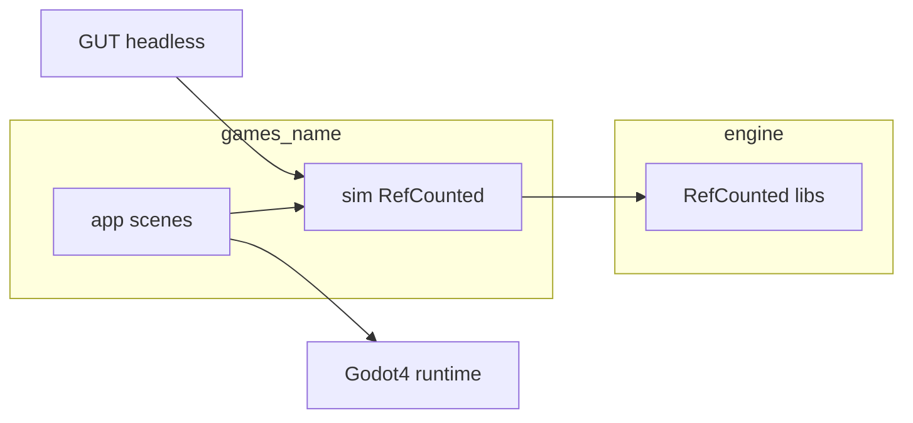

# Architecture

This lab keeps **rules** separate from **presentation**.

- `engine/` — shared typed GDScript libraries (`RefCounted` / `class_name`). No `Node`.
- `games/<name>/sim/` — that game's deterministic rules (`RefCounted`). No scene tree.
- `games/<name>/app/` — Godot scenes (`.tscn`) and Node scripts that **consume** sim state and events.
- `tests/` — GUT suites that construct sim/engine types headless.

Godot itself is the runtime shell (window, rendering, input to Nodes). It is not where rules live.

## Headless First

1. Implement the mechanic in `sim/` (or `engine/`).
2. Cover it with GUT under `tests/`.
3. Only then wire Nodes / `.tscn` in `app/`.

Sim code must not use `Node`, `get_tree()`, `Engine`, wall-clock `Time`, unseeded RNG, or `FileAccess`. Time advances by a fixed tick; randomness is seeded.

## Scene flow

Presentation changes the active UI through **explicit requests** (push / pop / replace / pause / quit style), documented per game under `games/<name>/docs/`. Do not invent a generic `SceneManager` type name unless this doc is updated to introduce one.

A thin lab launcher scene may eventually pick among games; until then `run/main_scene` in `project.godot` may be empty.
