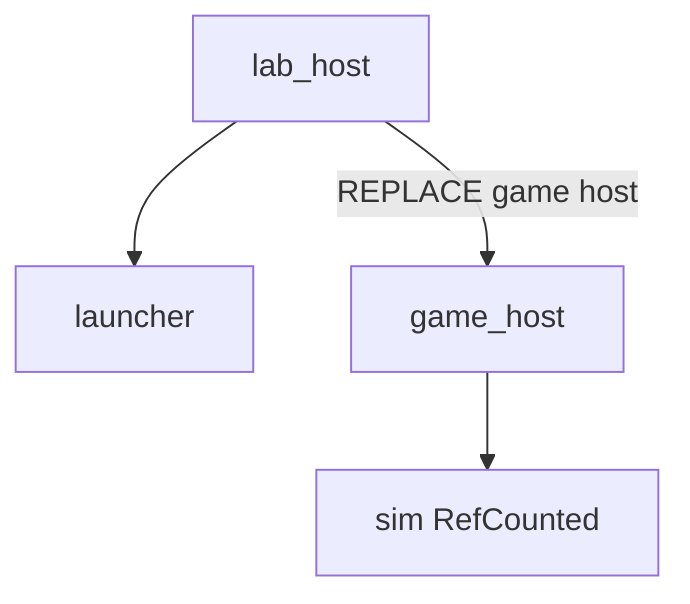
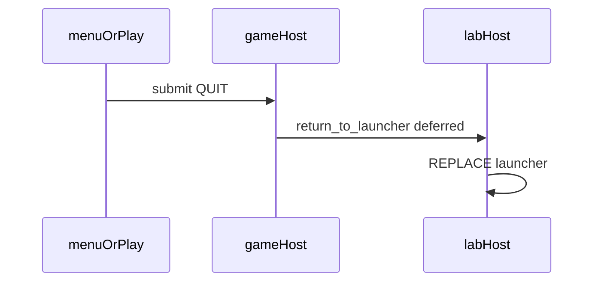

# Architecture

This lab keeps **rules** separate from **presentation**, and games nested under a **lab shell**.

- `engine/` — shared typed GDScript libraries (`RefCounted` / `class_name`). No `Node`.
- `lab/` — `LayeredHost`, lab host, launcher UI. `run/main_scene` points here.
- `games/<name>/sim/` — that game's deterministic rules (`RefCounted`). No scene tree.
- `games/<name>/app/` — game host + scenes that **consume** sim state and events.
- `tests/` — GUT suites that construct types headless.

## Headless First

1. Implement the mechanic in `sim/` (or `engine/`).
2. Cover it with GUT under `tests/`.
3. Only then wire Nodes / `.tscn` in `app/`.

Sim code must not use `Node`, `get_tree()`, `Engine`, wall-clock `Time`, unseeded RNG, or `FileAccess`.

## Scene flow

[`SceneRequest`](../reference/engine-scene-stack.md) / [`SceneStack`](../reference/engine-scene-stack.md) live in `engine/`. [`LayeredHost`](../reference/lab-shell.md) applies `paths()` and keeps lower layers alive on `PUSH`.

Nested hosts: lab stack holds launcher or a game host; each game host has its own stack for menu / play / pause. Game Quit returns to the launcher via `return_to_launcher()`; only the lab Quit exits the process.

