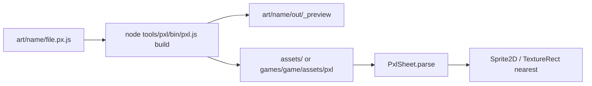

# Make pixel art with pxl

Build 2D sprites as code with the vendored CLI, then import PNGs into Godot.



## Prerequisites

- Node ≥ 22.18 (`node --version`)
- Vendored tool at [`tools/pxl/`](../../tools/pxl/) (see `VENDOR.md`)

Alias:

```sh
PXL="node tools/pxl/bin/pxl.js"
```

## Steps

1. Write `art/<name>/<file>.px.js` (palette + `sprite` / `anim` / `sheet`). Skill:
   [pixel-art-pxl](../../.cursor/skills/pixel-art-pxl/SKILL.md).
2. Scratch build with previews:
   ```sh
   $PXL build art/<name>/<file>.px.js
   ```
   Inspect `art/<name>/out/_preview/*.png` or `$PXL ascii art/<name>/<file>.px.js <asset>`.
3. Commit ship assets without previews:
   ```sh
   $PXL build art/<name>/<file>.px.js --out assets/<demo> --no-preview
   # or --out games/<game>/assets/pxl --no-preview
   ```
4. Import: `godot --path . --headless --import`.
5. In app code: nearest filter + `PxlSheet.parse` ([engine-pxl-sheet.md](../reference/engine-pxl-sheet.md)).

`art/**/out/` is gitignored. `art/` and `tools/` have `.gdignore` so Godot skips them.

## Demo

Source: [`art/pixel_demo/demo.px.js`](../../art/pixel_demo/demo.px.js).  
Outputs: [`assets/pixel_demo/`](../../assets/pixel_demo/).  
Lab UI: launcher → **Pixel Gallery** (`lab/pixel_gallery.tscn`).

## Related

- Full DSL: `.cursor/skills/pixel-art-pxl/references/reference.md`
- Lighting: `.cursor/skills/pixel-art-pxl/references/lighting.md`
