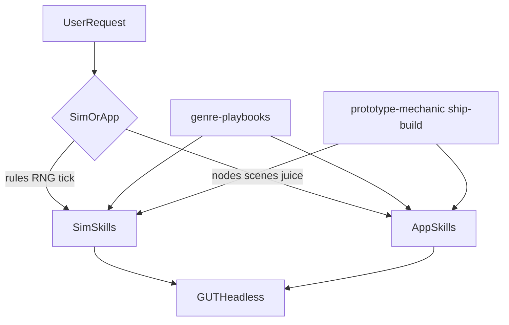

# Agent skills map

Cursor Agent Skills for this lab live under [`.cursor/skills/`](../../.cursor/skills/).
Each `SKILL.md` is loaded on demand from its frontmatter `description`. There is no
upstream-style router: pick by layer (sim vs app) and task.

Adapted from [gamedev-skills/awesome-gamedev-agent-skills](https://github.com/gamedev-skills/awesome-gamedev-agent-skills)
(Apache-2.0); see [NOTICE](../../NOTICE). Rewritten for Headless First, Godot **4.3**,
GUT, and Diátaxis.

## Composition

## Lab scaffolding (existing)

| Skill | Triggers | Layer |
|-------|----------|-------|
| [add-game](../../.cursor/skills/add-game/SKILL.md) | new game, scaffold title | both |
| [add-entity](../../.cursor/skills/add-entity/SKILL.md) | new `class_name`, engine/sim/app type | both |
| [add-scene](../../.cursor/skills/add-scene/SKILL.md) | new `.tscn`, menu/play/pause | app |
| [update-docs](../../.cursor/skills/update-docs/SKILL.md) | Diátaxis sweep, stale docs | docs |
| [run-build-and-tests](../../.cursor/skills/run-build-and-tests/SKILL.md) | verify, GUT, CI, headless hang | verify |
| [multi-agent-implementation-plan](../../.cursor/skills/multi-agent-implementation-plan/SKILL.md) | parallel Grok slices | process |

## Sim layer

| Skill | Upstream sources | Triggers |
|-------|------------------|----------|
| [sim-physics](../../.cursor/skills/sim-physics/SKILL.md) | physics-tuning, godot-physics | integrator, tunneling, restitution, fixed tick physics |
| [procedural-gen](../../.cursor/skills/procedural-gen/SKILL.md) | procedural-gen | seed, dungeon, noise, loot table, WFC |
| [sim-bot-ai](../../.cursor/skills/sim-bot-ai/SKILL.md) | game-ai, ai-behavior-trees-utility-ai | bot, utility AI, FSM, pathfinding |
| [sim-data-resources](../../.cursor/skills/sim-data-resources/SKILL.md) | godot-resources | HoleDef, catalog, data-driven defs |
| [save-systems](../../.cursor/skills/save-systems/SKILL.md) | save-systems | save slots, migration, ScoreStore |
| [dialogue-systems](../../.cursor/skills/dialogue-systems/SKILL.md) | dialogue-systems | branching dialogue, Yarn-like graph |
| [level-design](../../.cursor/skills/level-design/SKILL.md) | level-design | pacing, authored levels, par, solvability |
| [sim-networking](../../.cursor/skills/sim-networking/SKILL.md) | godot-multiplayer | NetworkPort, lockstep, RPC adapter |

## App layer

| Skill | Upstream sources | Triggers |
|-------|------------------|----------|
| [godot-app-scripting](../../.cursor/skills/godot-app-scripting/SKILL.md) | godot-gdscript, godot-nodes-scenes, godot-signals-groups | Node lifecycle, LayeredHost, signals |
| [godot-3d-presentation](../../.cursor/skills/godot-3d-presentation/SKILL.md) | godot-3d-essentials | Camera3D, SubViewport, meshes, lights |
| [godot-2d-presentation](../../.cursor/skills/godot-2d-presentation/SKILL.md) | godot-2d-movement, godot-tilemap | TileMapLayer, 2D mirror of sim |
| [camera-systems](../../.cursor/skills/camera-systems/SKILL.md) | camera-systems | orbit, deadzone, fit, ViewFit |
| [game-feel](../../.cursor/skills/game-feel/SKILL.md) | game-feel, godot-animation | juice, shake, hit-stop, tween |
| [game-ui-ux](../../.cursor/skills/game-ui-ux/SKILL.md) | game-ui-ux, godot-ui-control | HUD, docks, themes, focus |
| [game-audio](../../.cursor/skills/game-audio/SKILL.md) | audio-design, godot-audio | buses, NullAudio, procedural SFX |
| [godot-shaders](../../.cursor/skills/godot-shaders/SKILL.md) | godot-shaders, shader-programming | canvas_item, spatial |
| [input-systems](../../.cursor/skills/input-systems/SKILL.md) | input-systems | InputState, rebind, buffer |
| [performance-optimization](../../.cursor/skills/performance-optimization/SKILL.md) | performance-optimization | profiler, draw calls, tick budget |
| [game-assets](../../.cursor/skills/game-assets/SKILL.md) | create-game-assets | palette, greybox, import |

## Genres and workflows

| Skill | Upstream sources | Triggers |
|-------|------------------|----------|
| [genre-playbooks](../../.cursor/skills/genre-playbooks/SKILL.md) | platformer, roguelike, rpg, fps-shooter, tower-defense, card-game, visual-novel, survival-crafting, puzzle | genre templates |
| [prototype-mechanic](../../.cursor/skills/prototype-mechanic/SKILL.md) | prototype-fast, game-jam | spike, vertical slice, keep/kill |
| [ship-build](../../.cursor/skills/ship-build/SKILL.md) | godot-export, itch-publish, steam-publish | export, butler, Steam |

## Non-negotiables (every skill)

1. Mechanics in `games/<game>/sim/` as `RefCounted`; presentation in `app/`.
2. No `Node`, `Engine`, wall-clock `Time`, unseeded RNG, or `FileAccess` in sim.
3. Randomness via `SeededRng`; time via `FixedTick.SEC`.
4. New behavior lands with a headless GUT suite.
5. Diátaxis entry in the same change.
