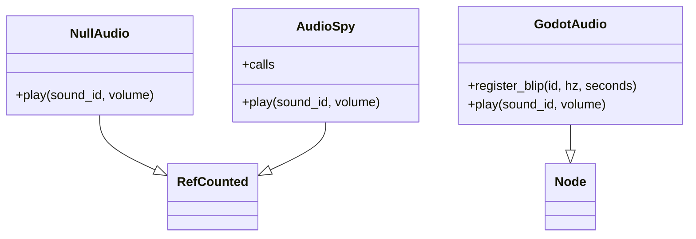

# Engine audio

Duck-typed playback port: any audio object exposes `play(sound_id: StringName, volume: float = 1.0)`. Sims never call audio; apps react to sim events.

## NullAudio

`engine/null_audio.gd` — headless no-op. Default when no host audio is found.

## AudioSpy

`tests/mocks/audio_spy.gd` — records `{id, volume}` for GUT assertions.

## GodotAudio

`lab/godot_audio.gd` — Node adapter (outside `engine/` because it uses the scene tree). Builds short square mono `AudioStreamWAV` blips via `register_blip`, plays through a pool of `AudioStreamPlayer` voices.

Snake host constructs `GodotAudio`, registers `eat` / `die`, and exposes `get_audio()`. Play walks parents for `get_audio` and plays on `ate` / `game_over` events.
