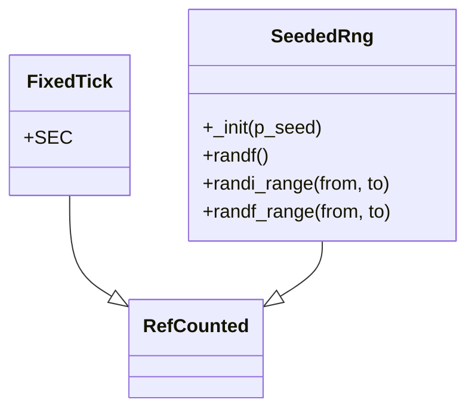

# Engine core

Headless types shared by every game sim. Both are `RefCounted` scripts under `engine/` with a `class_name`. They do not use `Node`, the scene tree, wall-clock time, or unseeded `rand*`.

## FixedTick

`FixedTick` holds the lab's simulation step.

| Member | Type | Value |
|--------|------|-------|
| `SEC` | `float` const | `1.0 / 60.0` |

Sim time advances only in multiples of `FixedTick.SEC` (one sixtieth of a second). Callers do not read `Time` or `Engine.get_frames_per_second()` to decide how far a rule moves.

## SeededRng

`SeededRng` wraps one `RandomNumberGenerator` created with the constructor seed.

| Method | Returns | Behavior |
|--------|---------|----------|
| `_init(p_seed: int = 0)` | `void` | Stores `p_seed` on the internal generator. Default seed is `0`. |
| `randf()` | `float` | Next float from that generator, in `[0, 1)`. |
| `randi_range(from, to)` | `int` | Next inclusive integer in `[from, to]`. |
| `randf_range(from, to)` | `float` | Next float in `[from, to]`. |

The same seed and the same call order produce the same values. A different seed produces a different sequence. Draws stay on this instance; the type does not call global `randf`, `randi`, or `randf_range`.
