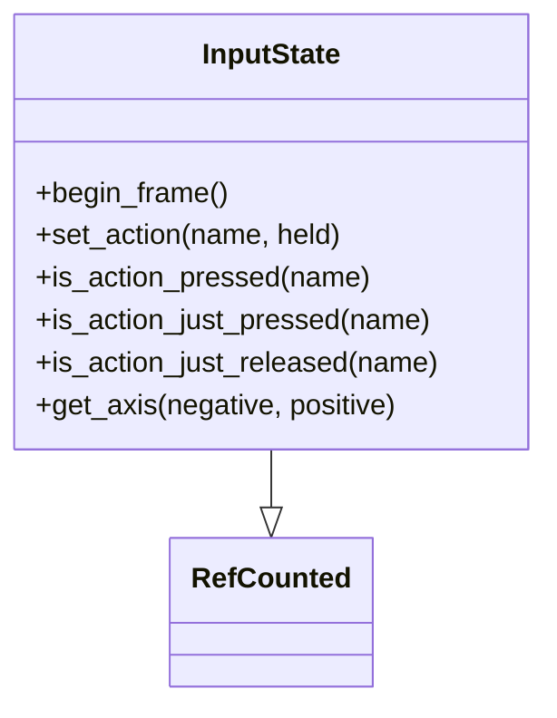

# Engine input

Headless frame input for apps that sample Godot `InputMap` (or any other source) and feed sims without calling `Input` inside `sim/` or `engine/` rules.

## InputState

`InputState` (`engine/input_state.gd`) stores held and edge state keyed by `StringName` (usually the same names as project InputMap actions). It does not read Godot `Input`.

| Method | Behavior |
|--------|----------|
| `begin_frame()` | Clears `just_pressed` / `just_released`; held values stay |
| `set_action(name, held)` | Updates held; sets edge flags vs the previous held value |
| `is_action_pressed(name)` | Current held |
| `is_action_just_pressed(name)` | Became held since last `begin_frame` |
| `is_action_just_released(name)` | Became released since last `begin_frame` |
| `get_axis(negative, positive)` | `-1.0` / `0.0` / `1.0` from held; both or neither → `0.0` |

Typical app loop in `_physics_process`: `begin_frame()`, then `set_action` for each movement action from `Input.is_action_pressed`, then read the state into `sim.set_input`. Pause and menu edges may still use `_unhandled_input` with Godot events.
