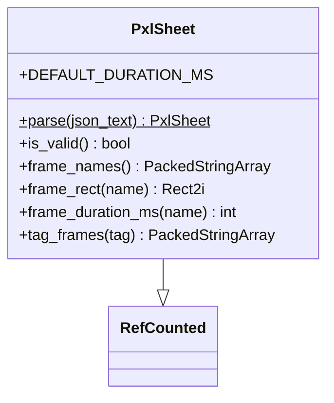

# PxlSheet

Headless parser for JSON written by the vendored [pxl](../../tools/pxl/) CLI
(`node tools/pxl/bin/pxl.js`). Extends `RefCounted`. Does **not** open files —
pass JSON text from the app / test.



## Formats

### Sheet / strip (`frames` hash)

TexturePacker-style hash. Each key is a frame name; `frame` holds `{x,y,w,h}` in
the atlas PNG. Optional `duration` (ms). Missing duration → `DEFAULT_DURATION_MS`
(100).

### Animation tags (`meta.frameTags`)

Aseprite-compatible tags with `name`, `from`, `to` (inclusive indices into the
ordered `frames` keys). `tag_frames(tag)` returns those frame names in order.

## Usage

```gdscript
var text := FileAccess.get_file_as_string("res://assets/pixel_demo/demo_sprites.json")
var sheet := PxlSheet.parse(text)
var rect := sheet.frame_rect(&"slime")
var atlas := AtlasTexture.new()
atlas.atlas = load("res://assets/pixel_demo/demo_sprites.png")
atlas.region = Rect2(rect)
```

App code owns `FileAccess` / `load`; the sim never calls this type for rules.

## Tests

`tests/engine/pxl_sheet_test.gd` — rects, default duration, tags, invalid JSON.
