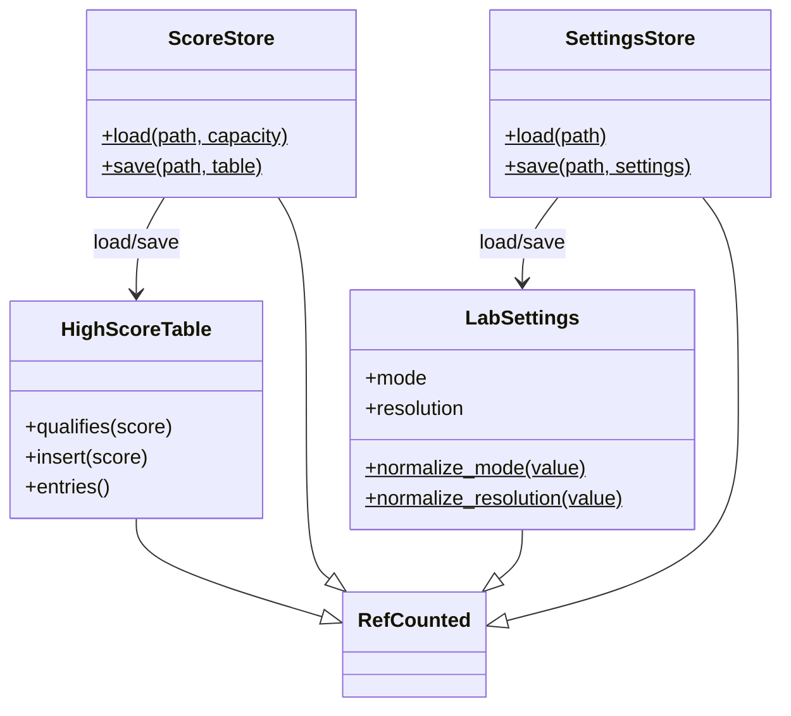

# Engine save

In-memory high-score table and lab display settings, plus small file stores. Sims never call these; app/lab code loads and saves.



## HighScoreTable

Fixed-capacity descending `int` list (`engine/high_score_table.gd`). Ties keep the older entry above a new equal score.

| API | Behavior |
|-----|----------|
| `_init(capacity)` | Capacity clamped to `>= 0` |
| `qualifies(score)` | Room remains, or `score` beats the lowest entry; rejects negatives and capacity `0` |
| `insert(score)` | Inserts descending; returns 0-based rank, or `-1` if dropped |
| `entries()` | Copy of scores, highest first |

## ScoreStore

Text persistence (`engine/score_store.gd`). **Exception:** this type may use `FileAccess` / `DirAccess`. Game `sim/` and other headless rule types must not.

Format: first line exactly `gg-highscores 1`, then one non-negative integer per line.

| API | Behavior |
|-----|----------|
| `load(path, capacity)` | Missing, corrupt, or IO failure → empty `HighScoreTable` of that capacity |
| `save(path, table)` | Ensures parent dir, writes `path.tmp`, renames into place; returns `false` on failure |

Snake uses `user://scores/snake.txt` with capacity `10`.

## LabSettings

Display profile (`engine/lab_settings.gd`): window mode and preferred resolution. Pure data; no filesystem.

| Field | Values | Default |
|-------|--------|---------|
| `mode` | `"windowed"` or `"fullscreen"` | `"windowed"` |
| `resolution` | one of `RESOLUTIONS` | `(1280, 720)` |

`RESOLUTIONS`: `(1280, 720)`, `(1600, 900)`, `(1920, 1080)`.

| API | Behavior |
|-----|----------|
| `normalize_mode(value)` | Unknown → `"windowed"` |
| `normalize_resolution(value)` | Unknown → `(1280, 720)` |
| `duplicate_settings()` | Independent copy |

## SettingsStore

Text persistence for `LabSettings` (`engine/settings_store.gd`). Same **FileAccess** exception as `ScoreStore`.

Format:

```
gg-settings 1
mode=windowed
resolution=1280x720
```

| API | Behavior |
|-----|----------|
| `load(path)` | Missing, corrupt, or IO failure → defaults; unknown resolution clamps to `(1280, 720)` |
| `save(path, settings)` | Atomic `.tmp` + rename; returns `false` on failure |

Lab path: `user://settings.txt` (`SettingsStore.DEFAULT_PATH`).
