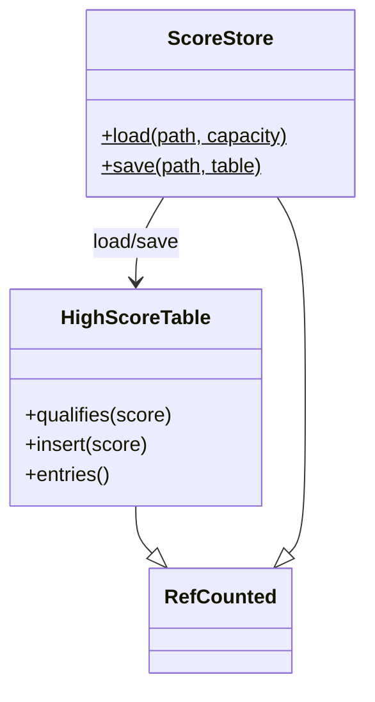

# Engine save

In-memory high-score table plus a small file store. Sims never call this; app code loads/saves after reading sim scores.

## HighScoreTable

Fixed-capacity descending `int` list (`engine/high_score_table.gd`). Ties keep the older entry above a new equal score.

| API | Behavior |
|-----|----------|
| `_init(capacity)` | Capacity clamped to `>= 0` |
| `qualifies(score)` | Room remains, or `score` beats the lowest entry; rejects negatives and capacity `0` |
| `insert(score)` | Inserts descending; returns 0-based rank, or `-1` if dropped |
| `entries()` | Copy of scores, highest first |

## ScoreStore

Text persistence (`engine/score_store.gd`). **Exception:** this type may use `FileAccess` / `DirAccess`. Game `sim/` and other headless rule types must not.

Format: first line exactly `gg-highscores 1`, then one non-negative integer per line.

| API | Behavior |
|-----|----------|
| `load(path, capacity)` | Missing, corrupt, or IO failure → empty `HighScoreTable` of that capacity |
| `save(path, table)` | Ensures parent dir, writes `path.tmp`, renames into place; returns `false` on failure |

Snake uses `user://scores/snake.txt` with capacity `10`.
