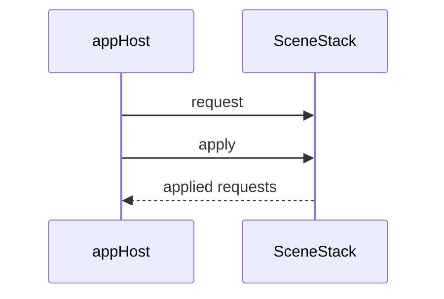

# Scene stack

Headless scene-flow types in `engine/`. They store path strings and request kinds. A host under `games/<name>/app/` (or a future lab launcher) reads the result and performs the Godot scene change. Overlay hosts call `paths()` and keep lower scenes alive when the stack grows.

## SceneRequest

`class_name SceneRequest extends RefCounted`

| Field | Type | Role |
|-------|------|------|
| `kind` | `Kind` | `PUSH`, `POP`, `REPLACE`, or `QUIT` |
| `scene_path` | `String` | Path for `PUSH` and `REPLACE`. Empty for `POP` and `QUIT`. |

| Constructor | Result |
|-------------|--------|
| `SceneRequest.push(path)` | `Kind.PUSH` with `scene_path` set |
| `SceneRequest.pop()` | `Kind.POP` |
| `SceneRequest.replace(path)` | `Kind.REPLACE` with `scene_path` set |
| `SceneRequest.quit()` | `Kind.QUIT` |

## SceneStack

`class_name SceneStack extends RefCounted`

Internal stack of scene path strings plus a pending request queue.

| Method | Behavior |
|--------|----------|
| `request(req)` | Enqueues `req`. The stack stays unchanged until `apply`. |
| `apply()` | Applies the queued requests in order, clears the queue, and returns those requests. |
| `peek()` | Current top path, or `""` when the stack is empty. |
| `depth()` | Number of paths on the stack. |
| `paths()` | Copy of the full path stack (bottom → top). Mutating the return value does not change the stack. |

`apply` rules:

| Kind | Effect |
|------|--------|
| `PUSH` | Push `scene_path`. |
| `POP` | Pop the top path when the stack is not empty. An empty stack stays empty. |
| `REPLACE` | Replace the top path (pop, then push). An empty stack receives the path as a push. |
| `QUIT` | Leave the stack unchanged. The request is still in the returned list so the host can quit. |

Requests enqueued during `apply` wait for the next `apply`. A second `apply` with an empty queue returns an empty array and leaves the stack as it is.

