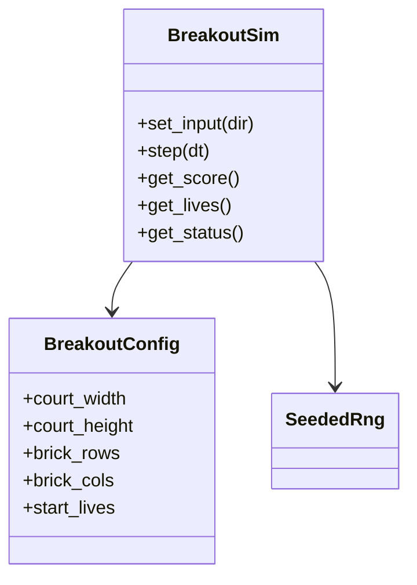

# Breakout sim

Headless brick-breaker rules. No `Node`, filesystem, or wall-clock.

## BreakoutConfig

Defaults: court `800×450`, paddle `80×12`, ball radius `6`, speed `320`, bricks `5×10`, `start_lives` `3`, `points_per_brick` `10`.

## BreakoutSim

| API | Behavior |
|-----|----------|
| `set_input(dir)` | `-1` / `0` / `1` horizontal paddle |
| `step(dt)` | Move paddle/ball; walls L/R/T; paddle angle bounce; brick AABB; bottom = life |
| Status | `playing`, `life_lost` (hold then serve), `game_over`, `cleared` |

Events: `brick_broken`, `life_lost`, `game_over`, `cleared`. Same seed + inputs → same trajectory (GUT).
