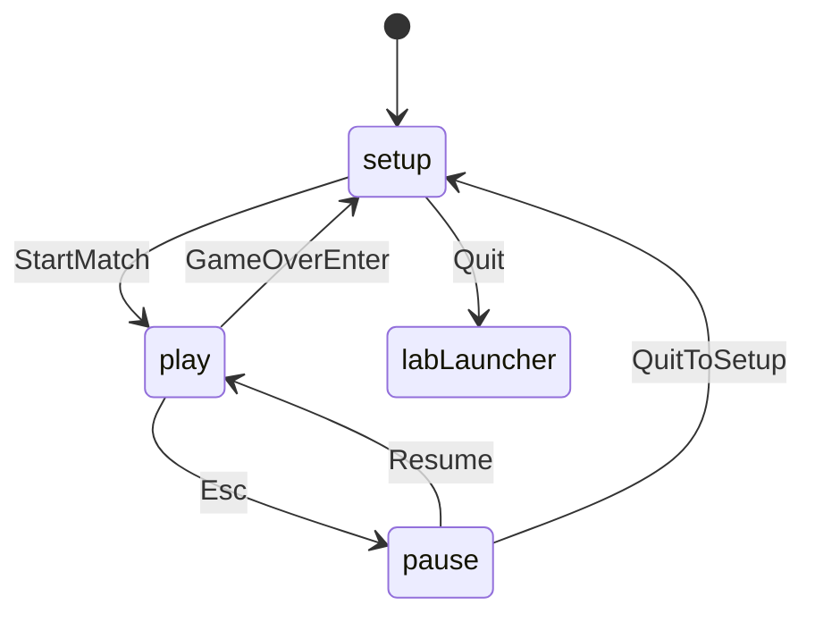

# Districts flow

Turn loop lives in `DistrictSim` (`roll` → resolve → optional `buy`/`skip` → next seat). Play queues those events through Tweens (dice → hops → offers) before unlocking input; bots call `bot_act` only when idle.
