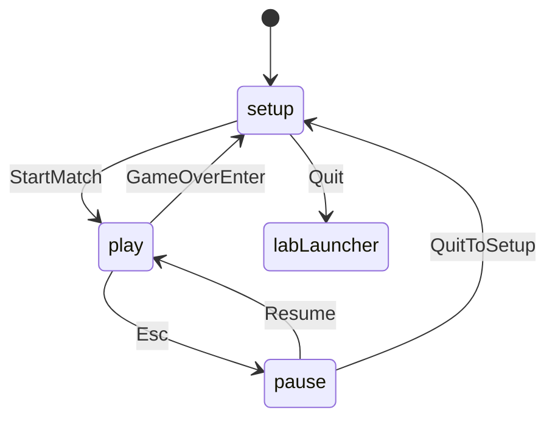
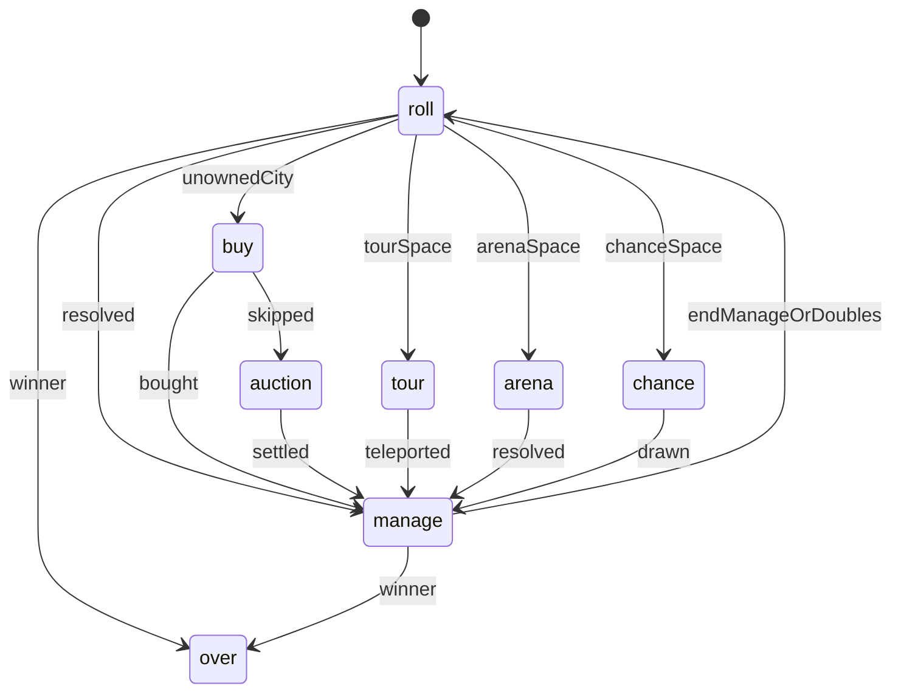

# Districts flow

Turn loop lives in `DistrictSim`. After movement resolution the seat often enters `manage` (build / gadgets / trade) before `end_manage` advances — doubles return to `roll`. Play queues sim events through Tweens before unlocking input; bots call `bot_act` only when idle. Online is stubbed via `MatchSession` + `LocalHotseatPort`.
