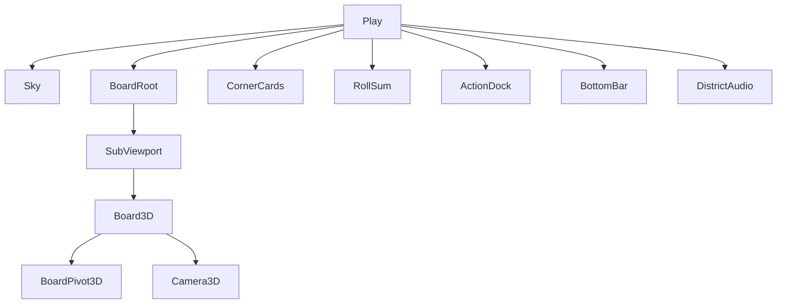

# Districts app

| Scene | Role |
|-------|------|
| `setup` | Seats, bot toggles (seat 1 human), table stake, Start / Back |
| `play` | 3D table in a SubViewport, corner player cards, phase actions, one-line feed |
| `pause_menu` | Resume or return to setup |

Setup calls `configure_match(..., table_stake)` on the host (`match_table_stake`). Play copies it onto `DistrictConfig.table_stake`, calls `apply_stake()`, then `setup`. Esc opens pause. Game over → Enter returns to setup.

## Board

`Board3D` lays the square track on the XZ plane. Edge and corner faces are `DistrictTileBaker` textures on planes (edge **80×112**, corners **112×112**), with the color band toward the outside of the ring. A grass plane and center plate sit under the ring. Optional cash stacks are decoration. Buildings are boxes whose height follows `get_build_level`; albedo is the owner's color. Pawns are billboard meeples.

The 2D `BoardPivot` path is no longer in `play.tscn`.

## Camera

`Camera3D` sits at about **40°** pitch and a fixed yaw so a corner of the table points toward the lens. **LMB** orbits `BoardPivot3D` around the center. **MMB/RMB** pan the focus. The wheel dollies distance. **Fit** sizes that distance from the board radius and the viewport aspect, and eases yaw back to the corner rest. While a pawn hops, yaw eases so that side faces the camera and the focus leans toward the space (`FOLLOW_LEAN` 0.32). It does not lock onto the meeple.

The page behind the viewport is a sky `ColorRect`. The 3D world uses `WorldEnvironment` background color of the same sky, not a dark panel.

## HUD

Four corner cards (avatar, nick `P1` or `Bot`, cash). A center label shows the roll sum. The bottom bar is one feed line, gadget buttons (`use_gadget`), and Menu.

| Phase | Control |
|-------|---------|
| `roll` | Roll, gadgets |
| `buy` | Buy / Pass |
| `manage` | Build, city trade Offer/Accept, Done (`end_manage`), gadgets |
| `auction` | Bid (high + 10) / Pass |
| `tour` | Option list, then `pick_tour_target` |
| `arena` | Resolve |
| `chance` | Draw, and an automatic resolve shortly after the phase opens |

## Juice

Play consumes sim events with Tweens: dice punch, pawn hops on 3D waypoints, tile flash, buy pop, cash ±$ on the seat card, building pop, camera shake on jail and bankrupt. Chance uses a flipping `Control` card. `DistrictAudio.play_cue` plays a named cue when a wav exists under `assets/sfx/`; otherwise it no-ops. Headless runs (`--headless` or the headless feature) route cues through `NullAudio` and skip board meshes so the dummy renderer is not asked for surfaces. Actions lock while `_busy`, so bot `bot_act` waits until the queue finishes. Unknown event types are still logged so the queue cannot stall.

## Assets

`games/districts/assets/` — Kenney meeples and dice (CC0). Space faces are procedural. Sfx files are optional. See `assets/LICENSE.txt`.
