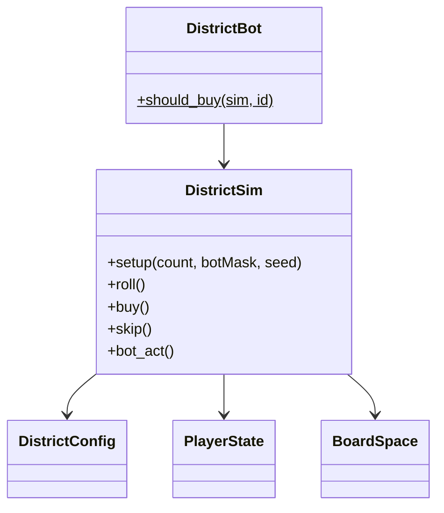

# Districts sim

Default board: 28 spaces (GO, property groups, tax, jail, free, goto-jail). Phases: `roll`, `buy`, `over`.

| API | Behavior |
|-----|----------|
| `setup(n, bot_mask, seed)` | 2–4 players; bit `i` in mask ⇒ seat `i` is bot |
| `roll` / `buy` / `skip` | Human (or tests) drive the phase |
| `bot_act` | If current seat is bot: roll or buy/skip via `DistrictBot` |

v1: no trading, auctions, buildings, or chance deck. Doubles grant an extra roll; three doubles → jail. Bankruptcy clears ownership to creditor or bank.
