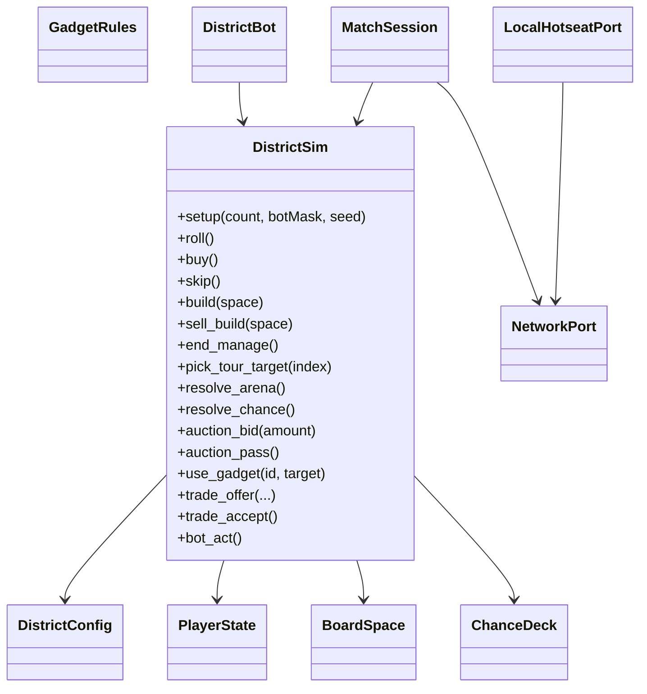

# Districts sim

Default board: **32** spaces (8 per side including corners). Corners: Plaza Gate (`go`), Lost Island (`jail`), World Championships (`arena`), World Tour (`tour`). Edge kinds: property groups, chance, tax (flat or `%`), goto-jail.

Phases: `roll` | `buy` | `manage` | `auction` | `tour` | `arena` | `chance` | `over`.

| API | Behavior |
|-----|----------|
| `setup(n, bot_mask, seed)` | 2–4 players; bit `i` ⇒ bot; starter gadgets |
| `roll` / `buy` / `skip` | Movement and purchase window |
| `build` / `sell_build` / `end_manage` | Monopoly builds in `manage` (and `roll` for gadgets) |
| `pick_tour_target` | Teleport without GO salary |
| `resolve_arena` | 1d6; win pot on 4+ |
| `resolve_chance` | Draw seeded `ChanceDeck` card |
| `auction_bid` / `auction_pass` | After `skip` on unowned city |
| `use_gadget` | Shield, DoubleRent, Reroll, StealCash, Freeze |
| `trade_offer` / `trade_accept` | Cash + cities swap in `manage` |
| `bot_act` | Drive current bot through any open phase |

`DistrictConfig`: `table_stake`, `go_salary`, `max_rounds` (0 = off), `gadget_uses_per_match`, `require_monopoly_to_build`, `arena_ante`, `parking_collects_tax`.

Online netcode is out of scope. `NetworkPort` / `LocalHotseatPort` / `MatchSession` are no-op ports for a later WebRTC/ENet layer.

## Event catalog

Every sim event is a `Dictionary` with `type` (String) plus payload. App matches on `type` only.

| type | Payload (typical) |
|------|-------------------|
| `rolled` | `player`, `d1`, `d2`, `total`, `doubles` |
| `moved` | `player`, `from`, `to`, `steps` |
| `passed_go` | `player`, `amount` |
| `offer_buy` | `player`, `space`, `price` |
| `bought` | `player`, `space`, `price` |
| `skipped_buy` | `player`, `space` |
| `paid_rent` | `from`, `to`, `space`, `amount` |
| `built` / `sold_build` | `player`, `space`, `level`, `cost`/`refund` |
| `taxed` | `player`, `amount` |
| `went_to_jail` / `left_jail` | `player`, optional `reason` |
| `chance_pending` / `chance_drawn` | `player`, `card` |
| `tour_pending` / `toured` | `player`, `from`, `to` |
| `arena_ante` / `arena_roll` / `arena_won` / `arena_miss` | pot fields |
| `auction_started` / `auction_bid` / `auction_pass` / `auction_won` / `auction_failed` | space / amounts |
| `gadget_used` / `buff_applied` / `buff_expired` / `shield_blocked` | gadget / buff |
| `trade_offered` / `trade_accepted` / `trade_rejected` | `trade` |
| `turn_changed` | `player` |
| `bankrupt` / `game_over` | `player` / `winner` |
| `frozen_skip` | `player`, `left` |
