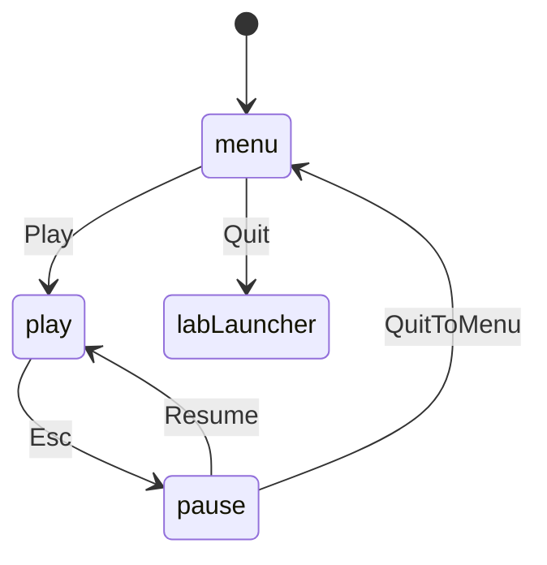
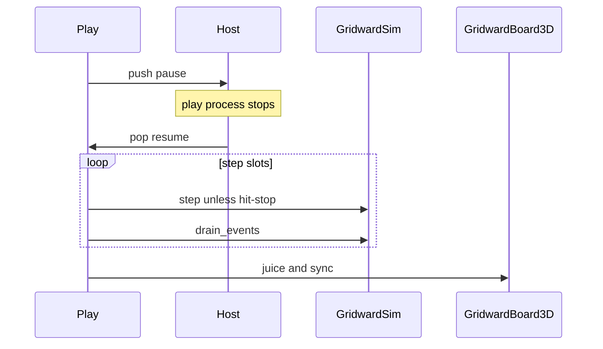
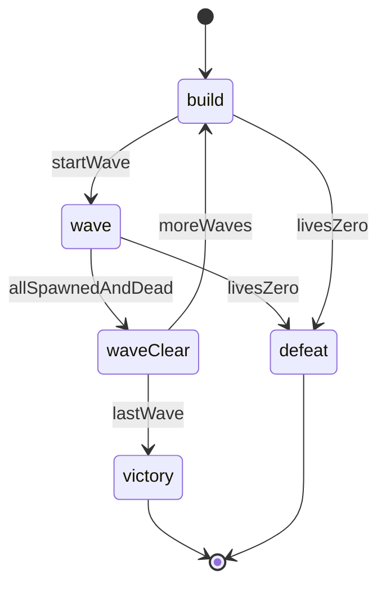
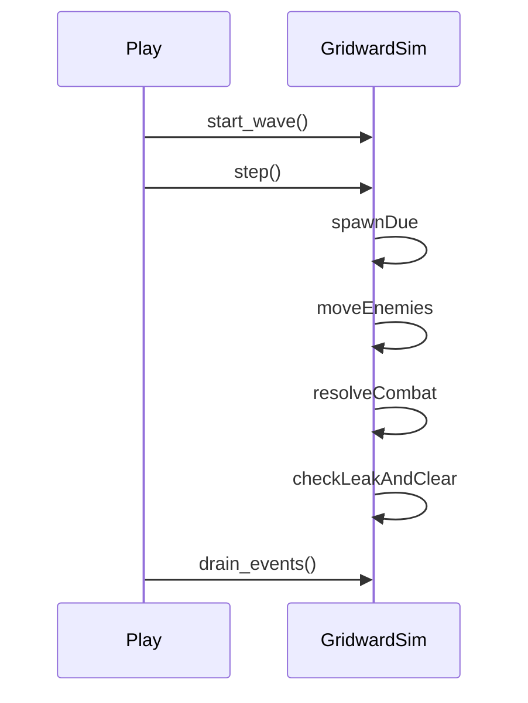

# Gridward scene flow

The host boots to the menu. Play replaces that layer and owns the match. Esc pushes pause on top of play. Resume pops back to play. Quit to menu pops pause and replaces play with the menu. Quit from the menu asks the lab to show the launcher again.

While pause is the top layer, `LayeredHost` sets play to `PROCESS_MODE_DISABLED`. Play's `_process` is what calls `step()`, so the match holds. The sim has no paused phase.

## Match phases

`GridwardSim` owns the match. Pause is app-only.

`start_wave()` moves `build` to `wave`. Each `step()` during `wave` spawns entries that are due, moves enemies along the waypoint polyline, then advances projectiles and lets ready towers acquire and fire. A leak removes that enemy and loses one life. Lives at 0 set `defeat` in that same step, including when the leaking enemy was the last one alive.

When every entry has spawned and no enemies remain, that step enters `waveClear` and pays the wave-clear bonus. A kill pays that enemy's catalog bounty. The next `step()` leaves `waveClear`: `build` plus the intermission timer and the next wave index when waves remain, or `victory` on the last wave. `start_wave()` during the timer pays the early-call bonus from [balance.md](../reference/balance.md). `start_wave()` returns false outside `build`. The opening build has no timer.

At 1×, play calls `step()` once per frame. At 2× it calls `step()` twice. A big kill sets `_skip_sim_steps`, and each following step slot is skipped until that count hits zero. Play drains events after every step that ran. Those events drive juice only. They do not call back into the sim.
