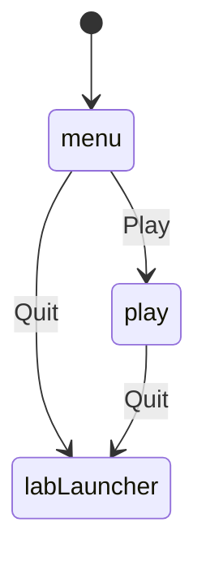
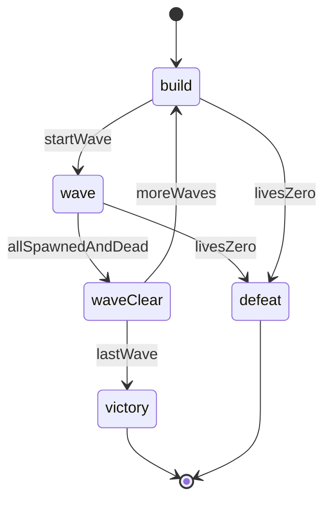

# Gridward scene flow

The host boots to the menu. Play replaces that layer with a placeholder. Quit from the menu (or a later quit on the host) asks the lab to show the launcher again.

## Match phases

`GridwardSim` owns the match. `paused` is app-only: the host stops calling `step()`. The sim does not model pause.

`start_wave()` moves `build` to `wave`. Each `step()` during `wave` spawns entries that are due, moves enemies along the waypoint polyline, then advances projectiles and lets ready towers acquire and fire. A leak removes that enemy and loses one life. Lives at 0 set `defeat` in that same step, including when the leaking enemy was the last one alive.

When every entry has spawned and no enemies remain, that step enters `waveClear` and pays the wave-clear bonus. A kill pays that enemy's catalog bounty. The next `step()` leaves `waveClear`: `build` plus the intermission timer and the next wave index when waves remain, or `victory` on the last wave. `start_wave()` during the timer pays the early-call bonus from [balance.md](../reference/balance.md). `start_wave()` returns false outside `build`. The opening build has no timer.

