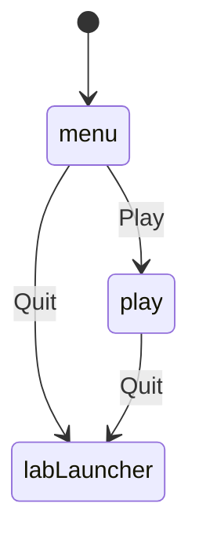
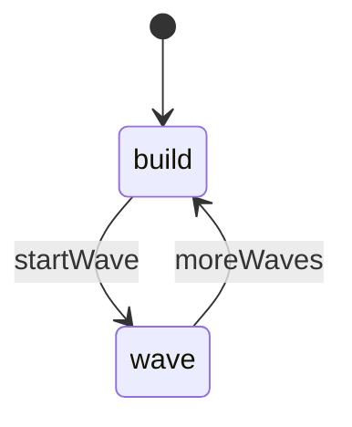

# Gridward scene flow

The host boots to the menu. Play replaces that layer with a placeholder. Quit from the menu (or a later quit on the host) asks the lab to show the launcher again.

Sim phases below are names only. No wave loop runs in this scaffold.

