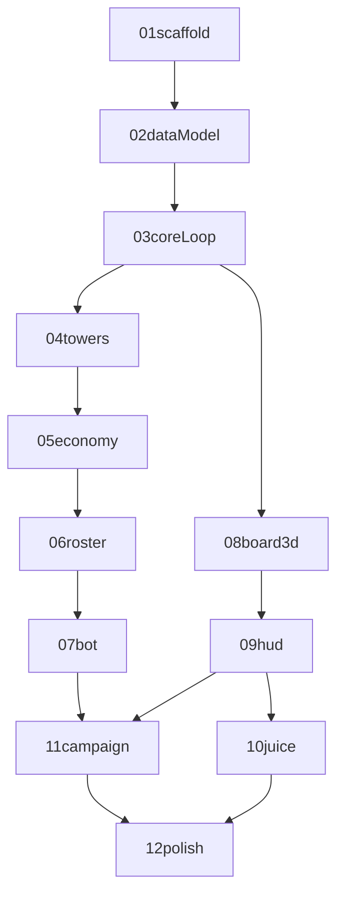

# 00 — Roadmap

## Goal

Order every implementation plan so an agent can ship Gridward without inventing
scope. Success: each later plan lists this file as a prerequisite and the
dependency edges below hold.

## Prerequisites

- [spec.md](../spec.md) accepted.

## Scope

**In:** milestone graph, DoD per wave, risk register, suggested commit cadence.  
**Out:** code.

## Dependency graph



Sim track (01–07) can finish before app polish; board (08) may start after 03.

## Milestones and definition of done

| Wave | Plans | DoD |
|------|-------|-----|
| M0 Docs | 00 | Spec + plans linked from game index |
| M1 Skeleton | 01–02 | Scaffold + catalog validates in GUT |
| M2 Playable headless | 03–05 | Waves + bolt tower + economy green |
| M3 Full sim | 06–07 | Roster + bot clears Meadow |
| M4 Presentable | 08–10 | 3D board + HUD + juice |
| M5 Product | 11–12 | Campaign save + polish checklist |

## Risk register

| Risk | Plan mitigation |
|------|-----------------|
| Overscoped maze | Spec non-goal; never reopen in 01–12 |
| Balance | 05 lane-holds + 07 bot seed sweep |
| Perf | 12 MultiMesh / pool |
| Doc drift | Each plan lists Diátaxis updates |

## Skills

`genre-playbooks` (tower-defense), `multi-agent-implementation-plan` (optional parallel), `update-docs`.

## Verify

```sh
test -f games/gridward/docs/spec.md
test -f games/gridward/docs/plans/12-polish-ship.md
```

## Todos / commit

- [x] This roadmap  
Commit with the rest of the docs drop: `Add Gridward tower defense spec and implementation plans.`
