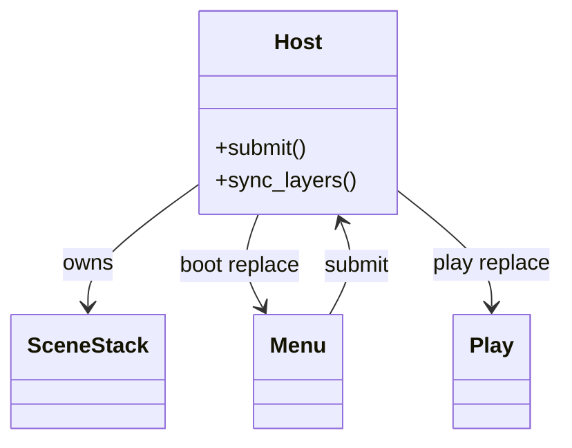

# Gridward app

Presentation shell for Gridward. Entry is `games/gridward/app/host.tscn` (extends `lab/layered_host.gd`), registered in the lab launcher as **Gridward**. Scenes submit `SceneRequest`s. They do not own match rules.

## Host

`_boot` `REPLACE`s `menu.tscn`. Window size stays lab-owned. `_on_quit_requested` walks parents for `return_to_launcher` and calls it deferred when nested; otherwise `get_tree().quit()`.

## Menu

| Button | Request |
|--------|---------|
| Play | `REPLACE` `play.tscn` |
| Quit | `QUIT` (returns to the lab launcher when nested) |

## Play

Placeholder scene. A label marks the stub. No sim, no board, no input rules.
