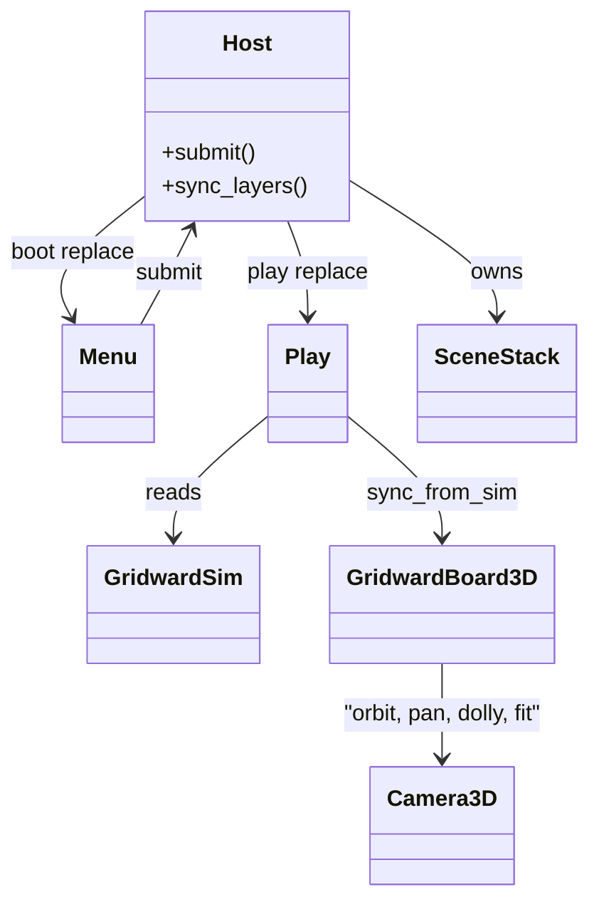
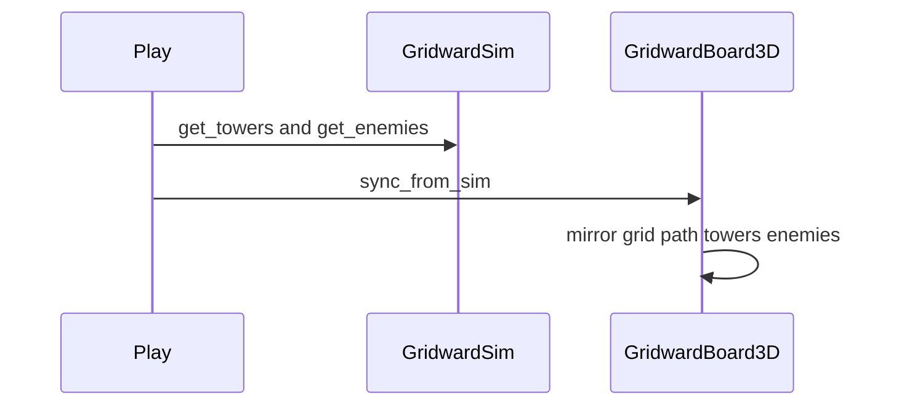

# Gridward app

Presentation shell for Gridward. Entry is `games/gridward/app/host.tscn` (extends `lab/layered_host.gd`), registered in the lab launcher as **Gridward**. Scenes submit `SceneRequest`s. They do not own match rules.

## Host

`_boot` `REPLACE`s `menu.tscn`. Window size stays lab-owned. `_on_quit_requested` walks parents for `return_to_launcher` and calls it deferred when nested; otherwise `get_tree().quit()`.

## Menu

| Button | Request |
|--------|---------|
| Play | `REPLACE` `play.tscn` |
| Quit | `QUIT` (returns to the lab launcher when nested) |

## Play

Play embeds `GridwardBoard3D` in a `SubViewport` and mirrors a Meadow `GridwardSim`. A single label is the stub HUD. Lives, gold, the build bar, and wave controls are not in this scene.

The board reads towers and enemies each frame. It does not call `step()` and does not place towers. LMB drag orbits, RMB or MMB pans, the wheel dollies, and F fits the grid. The cursor ghost is green on an empty buildable cell and red otherwise.

## Board

Script class is `GridwardBoard3D`. The scene node is `Board3D`. Districts already registers the global name `Board3D`.

One world unit is one cell. `cell_to_world` is the cell center on Y=0: cell `(x, y)` maps to `(x + 0.5, 0, y + 0.5)`. `world_to_cell` floors X and Z. Waypoints and enemies use the same half-cell offset through `point_to_world`. Path bars yaw with `yaw_for_xz_delta` (`atan2(-dz, dx)`), the same XZ convention as Fairway `Course3D`.

`cell_at_screen` casts the camera ray onto Y=0. A miss returns `MISS_CELL` (`Vector2i(2147483647, 2147483647)`), the integer stand-in for INF. `set_ghost` shows a green or red column, and hides it for `MISS_CELL`.

Cells, the path, towers, and enemies are boxes and cylinders parented to `BoardPivot3D`. The pivot stays put. Orbit, pan, dolly, and fit move `Camera3D` around the board center at about 40° pitch. `DisplayServer` headless (or the headless feature) skips every `MeshInstance3D`, including the ghost. Lights and the camera rig still exist.

