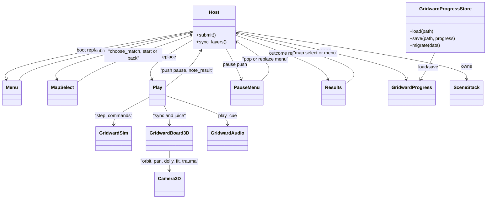
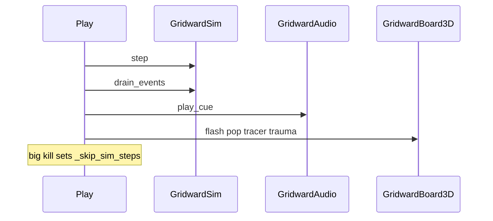
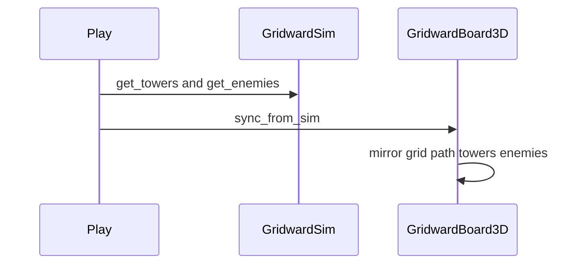

# Gridward app

Presentation shell for Gridward. Entry is `games/gridward/app/host.tscn` (extends `lab/layered_host.gd`), registered in the lab launcher as **Gridward**. Scenes submit `SceneRequest`s. They do not own match rules.

## Host

`_boot` loads progress, then `REPLACE`s `menu.tscn`. Window size stays lab-owned. `_on_quit_requested` walks parents for `return_to_launcher` and calls it deferred when nested; otherwise `get_tree().quit()`.

The host keeps `progress`, `selected_map`, and `selected_difficulty`. `choose_match` stores the map select choice. `note_result` writes result meta for the results scene. On a win it calls `record_victory` and `GridwardProgressStore.save`. A loss does not write the file. An ancestor meta `gridward_progress_path` overrides the save path. The default is `user://gridward/progress.txt`.

## Menu

| Button | Request |
|--------|---------|
| Play | `REPLACE` `map_select.tscn` |
| Quit | `QUIT` (returns to the lab launcher when nested) |

## Map select

Five map buttons, one per `GridwardCatalog.MAP_IDS`, plus Easy / Normal / Hard. A locked map is disabled and reads "locked". An open map shows its best stars (`★★★` down to `☆☆☆`). Start calls `choose_match` and `REPLACE`s `play.tscn` when that map is unlocked. Back `REPLACE`s the menu. Meadow grabs focus. Meadow is the default map and Normal is the default difficulty. Returning from results restores the last choice when it is still unlocked.

## Results

Shown after victory or defeat. The title is Victory or Defeat. Stars are the stars earned on this clear, or "No stars" after a loss. The detail line is map, difficulty, and lives left. Map select `REPLACE`s `map_select.tscn` and grabs focus. Menu `REPLACE`s the menu.

## Progress file

`GridwardProgressStore` is the only Gridward type that calls `FileAccess`. The text format is a header `gg-gridward-progress 1` and one `map difficulty stars` line per non-zero clear (`meadow normal 3`). Stars are 1–3. `load` of a missing or corrupt file returns an empty `GridwardProgress`. `save` writes `path.tmp` and renames it into place. `migrate` copies the dictionary forward while `version < CURRENT` (1). Version 1 has no field changes. `apply_state` runs after migrate.

## Play

Play embeds `GridwardBoard3D` in a `SubViewport`, builds the host's selected map at the selected difficulty, and steps that `GridwardSim`. With no host it uses Meadow on Normal. Starting gold is `GridwardConfig.scaled_gold`. Spawn HP uses the difficulty config assigned before the first step. When the phase becomes victory or defeat, play calls `note_result` and `REPLACE`s `results.tscn`. Each frame calls `step()` once, or twice when speed is 2×, unless hit-stop is skipping steps. When pause is the top layer, `LayeredHost` disables play's process, so `step()` does not run. Events are drained after commands and after each step that ran. The board mirrors state and plays juice. It does not change rules.

| Corner / dock | Shows |
|---------------|--------|
| Top left `LivesGold` | Lives, gold |
| Top center `TutorialHint` | Meadow teach-then-test line; hidden on other maps |
| Top right `WaveCard` | Wave index, 1× / 2×, Shake On / Off |
| Right `TowerPanel` | Selected tower: upgrade cost, sell, targeting |
| Bottom `BottomDock` | Next or current wave, build bar 1–5, Start Wave / Early Call, Menu |

On Meadow, a top-center `TutorialHint` label follows `meadow_hint`. Wave 0 teaches placing a bolt, wave 1 tests a larger grunt pack, wave 2 teaches runners, and later waves test the mix. Victory, defeat, and every other map hide the label. The text does not change gold, lives, or placement.

The wave card includes Shake. It defaults to Shake On. Shake Off calls `GridwardBoard3D.set_shake_enabled(false)`, which clears trauma and ignores new trauma until it is turned on again. `LabSettings` only stores display mode and resolution, so this flag is not written by `SettingsStore`.

The build bar lists `GridwardCatalog.TOWER_IDS` in order. Each button shows that tower's frame from `games/gridward/assets/pxl/icons.png`, parsed with `PxlSheet`, as an `AtlasTexture` with `TEXTURE_FILTER_NEAREST` and `expand_icon` off. The source is `art/gridward/icons.px.js` ([make pixel art](../../../../docs/how-to/make-pixel-art.md)). A type the map has not unlocked is disabled. Meadow starts with bolt selected. LMB on an empty buildable cell calls `place_tower` for the selected type. LMB on a tower selects it and opens the panel. RMB sells the tower under the cursor, or the selected tower when the cursor is on empty ground. Upgrade uses `GridwardSim.upgrade_cost` with default `GridwardConfig` factors, the same defaults the sim constructs. Sell calls `sell_tower`. The targeting list calls `set_targeting`.

Start Wave calls `start_wave`. During the post-clear intermission the button reads Early Call and the bonus from `early_call_bonus`. The preview line lists the current wave's counts. Victory and defeat replace that line and disable the button.

LMB drag orbits. MMB pans. The wheel dollies. The cursor ghost is green when `place_tower` would accept the selected type, and red otherwise.

## Input

Play registers these actions on the `InputMap` if they are missing, then samples them into `InputState` once per frame. Escape uses the built-in `ui_cancel` action.

| Action | Key | Command |
|--------|-----|---------|
| `gridward_tower_1` … `gridward_tower_5` | 1–5 (and keypad) | Select tower type |
| `gridward_start_wave` | Space | `start_wave` |
| `gridward_fit` | F | Fit camera |
| `gridward_speed` | Tab | Toggle 1× / 2× |
| `ui_cancel` | Esc | Push pause |

`_input` marks those events handled so Tab does not move focus and Space does not activate a focused button.

## Pause

`pause_menu.tscn` is a dimmed layer with Resume and Quit to menu. Resume grabs focus and pops. Quit to menu pops, then replaces play with the menu. Esc on the pause layer pops. The host does not tick the sim.

## Board

Script class is `GridwardBoard3D`. The scene node is `Board3D`. Districts already registers the global name `Board3D`.

One world unit is one cell. `cell_to_world` is the cell center on Y=0: cell `(x, y)` maps to `(x + 0.5, 0, y + 0.5)`. `world_to_cell` floors X and Z. Waypoints and enemies use the same half-cell offset through `point_to_world`. Path bars yaw with `yaw_for_xz_delta` (`atan2(-dz, dx)`), the same XZ convention as Fairway `Course3D`.

`cell_at_screen` casts the camera ray onto Y=0. A miss returns `MISS_CELL` (`Vector2i(2147483647, 2147483647)`), the integer stand-in for INF. `set_ghost` shows a green or red column, and hides it for `MISS_CELL`.

Cells, the path, towers, and in-flight shells are boxes, cylinders, and spheres parented to `BoardPivot3D`. Shells mirror `get_projectiles()`. Enemies share one `MultiMeshInstance3D` per id under `Enemies`. `pooled_capacity` keeps at least 8 slots and doubles when a wave needs more. `visible_instance_count` is the live count, so a cleared wave does not free the batch. Each map is 16×10, and the batch AABB covers that board so instances are not culled. `enemy_metrics` is radius, height, and lift. `enemy_origin` is the world point stored per id. Tracers, flashes, and pops read `enemy_anchor` from that store.

The pivot stays put. Orbit, pan, dolly, and fit move `Camera3D` around the board center at about 40° pitch. Trauma adds a decaying offset to that camera pose only, and only while shake is enabled. `DisplayServer` headless (or the headless feature) skips mesh nodes, including MultiMesh batches, the ghost, shells, and juice meshes. Anchors still update. Lights and the camera rig still exist.

## Feedback

`GridwardAudio.reaction` is a pure map from one event dictionary to a cue, volume, trauma, hit-stop count, and VFX id. Play applies it. The sim is not called back, and juice does not draw from the sim RNG.

Headless play and GUT use `NullAudio` (or an injected port such as `AudioSpy`). A windowed session builds `GodotAudio` blips inside `GridwardAudio`. There is no music bus.

Hit-stop sets `_skip_sim_steps` to 4. The host then withholds that many later `step()` calls. It does not change `Engine.time_scale` or the sim.

| Event | VFX | Cue | Trauma | Hit-stop |
|-------|-----|-----|--------|----------|
| `enemy_hit` | white flash mesh | `hit` | | |
| `enemy_killed` bounty under 50 | death pop (`TRANS_BACK`) | `kill` | | |
| `enemy_killed` boss, or bounty ≥ 50 | death pop | `kill_big` | 0.34 | 4 steps |
| `enemy_leaked` | | `leak` | 0.62 | |
| `tower_fired` hitscan or beam | tracer from tower to enemy | `fire` | | |
| `tower_fired` projectile | shell mesh from sim state | `fire` | | |
| `projectile_impact` | shockwave scaled by splash | `impact` | | |
| `tower_placed` | | `place` | | |
| `tower_sold` | | `sell` | | |
| `tower_upgraded` | | `upgrade` | | |
| `wave_started` | | `wave` | | |
| `wave_cleared` | | `clear` | | |
| `victory` | | `victory` | | |
| `defeat` | | `defeat` | 0.75 | |

