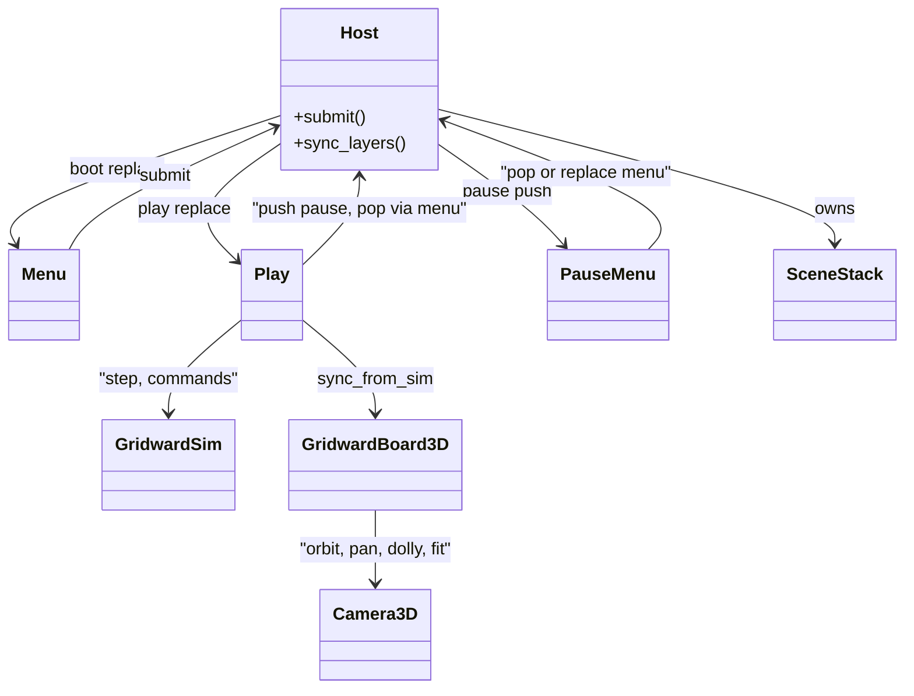
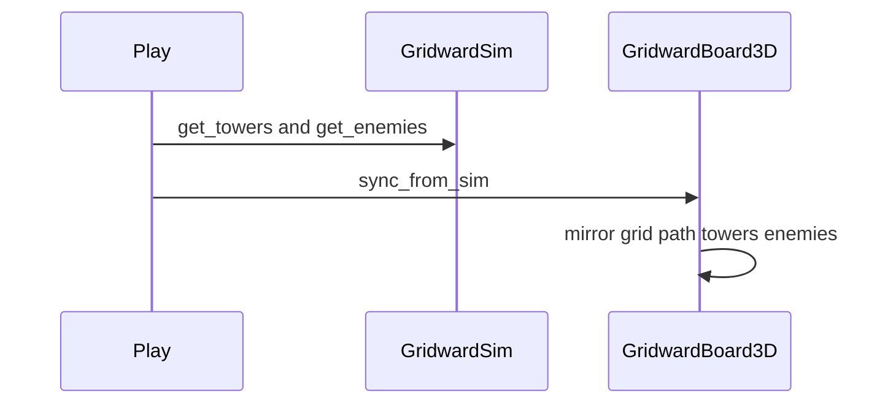

# Gridward app

Presentation shell for Gridward. Entry is `games/gridward/app/host.tscn` (extends `lab/layered_host.gd`), registered in the lab launcher as **Gridward**. Scenes submit `SceneRequest`s. They do not own match rules.

## Host

`_boot` `REPLACE`s `menu.tscn`. Window size stays lab-owned. `_on_quit_requested` walks parents for `return_to_launcher` and calls it deferred when nested; otherwise `get_tree().quit()`.

## Menu

| Button | Request |
|--------|---------|
| Play | `REPLACE` `play.tscn` |
| Quit | `QUIT` (returns to the lab launcher when nested) |

## Play

Play embeds `GridwardBoard3D` in a `SubViewport`, owns a Meadow `GridwardSim`, and steps it. Each frame calls `step()` once, or twice when speed is 2×. When pause is the top layer, `LayeredHost` disables play's process, so `step()` does not run. Events are drained after commands and after those steps. The board only mirrors state.

| Corner / dock | Shows |
|---------------|--------|
| Top left `LivesGold` | Lives, gold |
| Top right `WaveCard` | Wave index, 1× / 2× button |
| Right `TowerPanel` | Selected tower: upgrade cost, sell, targeting |
| Bottom `BottomDock` | Next or current wave, build bar 1–5, Start Wave / Early Call, Menu |

The build bar lists `GridwardCatalog.TOWER_IDS` in order. A type the map has not unlocked is disabled. Meadow starts with bolt selected. LMB on an empty buildable cell calls `place_tower` for the selected type. LMB on a tower selects it and opens the panel. RMB sells the tower under the cursor, or the selected tower when the cursor is on empty ground. Upgrade uses `GridwardSim.upgrade_cost` with default `GridwardConfig` factors, the same defaults the sim constructs. Sell calls `sell_tower`. The targeting list calls `set_targeting`.

Start Wave calls `start_wave`. During the post-clear intermission the button reads Early Call and the bonus from `early_call_bonus`. The preview line lists the current wave's counts. Victory and defeat replace that line and disable the button.

LMB drag orbits. MMB pans. The wheel dollies. The cursor ghost is green when `place_tower` would accept the selected type, and red otherwise.

## Input

Play registers these actions on the `InputMap` if they are missing, then samples them into `InputState` once per frame. Escape uses the built-in `ui_cancel` action.

| Action | Key | Command |
|--------|-----|---------|
| `gridward_tower_1` … `gridward_tower_5` | 1–5 (and keypad) | Select tower type |
| `gridward_start_wave` | Space | `start_wave` |
| `gridward_fit` | F | Fit camera |
| `gridward_speed` | Tab | Toggle 1× / 2× |
| `ui_cancel` | Esc | Push pause |

`_input` marks those events handled so Tab does not move focus and Space does not activate a focused button.

## Pause

`pause_menu.tscn` is a dimmed layer with Resume and Quit to menu. Resume grabs focus and pops. Quit to menu pops, then replaces play with the menu. Esc on the pause layer pops. The host does not tick the sim.

## Board

Script class is `GridwardBoard3D`. The scene node is `Board3D`. Districts already registers the global name `Board3D`.

One world unit is one cell. `cell_to_world` is the cell center on Y=0: cell `(x, y)` maps to `(x + 0.5, 0, y + 0.5)`. `world_to_cell` floors X and Z. Waypoints and enemies use the same half-cell offset through `point_to_world`. Path bars yaw with `yaw_for_xz_delta` (`atan2(-dz, dx)`), the same XZ convention as Fairway `Course3D`.

`cell_at_screen` casts the camera ray onto Y=0. A miss returns `MISS_CELL` (`Vector2i(2147483647, 2147483647)`), the integer stand-in for INF. `set_ghost` shows a green or red column, and hides it for `MISS_CELL`.

Cells, the path, towers, and enemies are boxes and cylinders parented to `BoardPivot3D`. The pivot stays put. Orbit, pan, dolly, and fit move `Camera3D` around the board center at about 40° pitch. `DisplayServer` headless (or the headless feature) skips every `MeshInstance3D`, including the ghost. Lights and the camera rig still exist.

