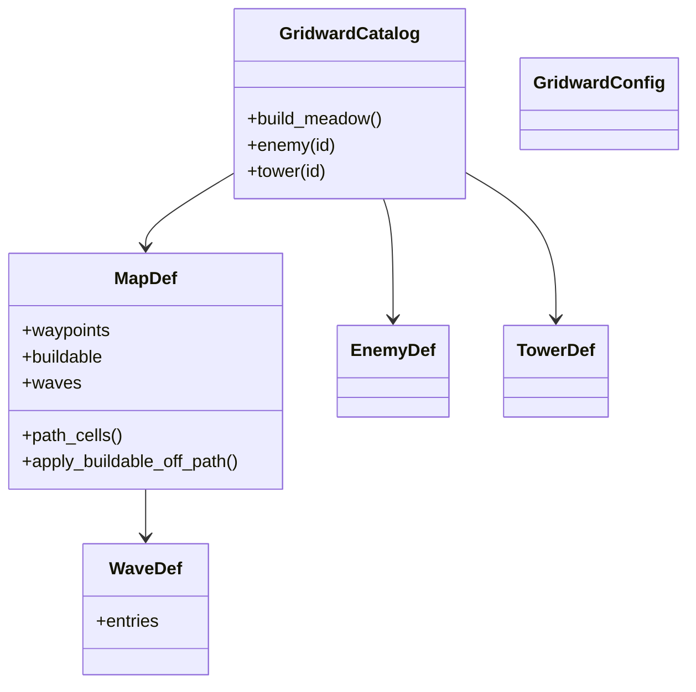

# Gridward sim

Headless content for the campaign. `GridwardCatalog` builds defs in code. A match reads those defs; this package does not step time. Scripts under `games/gridward/sim/` are `RefCounted` and stay free of `Node`, the scene tree, wall-clock `Time`, unseeded RNG, and `FileAccess`.

Product numbers are copied from [spec.md](../spec.md) §§5–9. Phase names for a running match stay in [flow.md](../explanation/flow.md).

## Ownership

`enemy(id)` and `tower(id)` return a new def on each call. An unknown id returns `null`. `GridwardConfig` is a separate tunable bag (Normal defaults). The catalog does not load files.

## GridwardConfig

| Field | Normal default | Role |
|-------|----------------|------|
| `hp_scale` | 1.12 | `hp * pow(hp_scale, wave_index)` |
| `sell_refund` | 0.70 | fraction of invested cost |
| `wave_clear_bonus_base` | 25 | clear gold base |
| `wave_clear_bonus_per_index` | 5 | added once per wave index |
| `early_call_ticks_per_gold` | 30 | `floor(remaining_ticks / this)` |
| `early_call_gold_cap` | 40 | early-call gold cap |
| `upgrade_cost_factor` | 0.75 | `round(base_cost * factor * pow(growth, t))` |
| `upgrade_cost_growth` | 1.55 | upgrade curve base |
| `tier_damage_scale` | 1.35 | damage growth per tier above 0 |
| `tier_range_scale` | 1.08 | range growth per tier above 0 |
| `max_tier` | 2 | tiers 0–2 |
| `min_damage` | 1 | damage left after armor |
| `slow_cap` | 0.60 | max slow fraction |
| `burn_max_stacks` | 5 | burn stack cap |
| `burn_damage_per_stack` | 1 | burn damage per tick per stack |
| `spawn_jitter_ticks` | 0 | spawn timing jitter |
| `difficulty_hp` | 1.0 | caller-applied HP multiplier |
| `difficulty_gold` | 1.0 | caller-applied gold multiplier |

Difficulty presets on the type: Easy `EASY_HP` 0.85 / `EASY_GOLD` 1.15, Normal `NORMAL_HP` 1 / `NORMAL_GOLD` 1, Hard `HARD_HP` 1.25 / `HARD_GOLD` 0.9. Assign them onto `difficulty_hp` and `difficulty_gold`.

## MapDef

| Field | Meaning |
|-------|---------|
| `id` | `StringName` |
| `width`, `height` | cell counts |
| `waypoints` | `PackedVector2Array` of cell indices |
| `buildable` | `PackedByteArray`, row-major `y * width + x`, `1` buildable, `0` path |
| `starting_gold`, `starting_lives` | match start |
| `waves` | `Array[WaveDef]` |
| `unlocked_towers` | tower ids the player may place |

`path_cells()` walks the polyline one cell at a time. Orthogonal segments include every cell on the segment. `apply_buildable_off_path()` sets the mask from that walk: path cells are `0`, every other in-bounds cell is `1`. `cell_index(cell)` is `y * width + x`. `is_buildable(cell)` is false outside the map.

### WaveDef entries

Each entry is a `Dictionary`:

| Key | Type |
|-----|------|
| `enemy_id` | `StringName` |
| `count` | `int` |
| `spacing_ticks` | `int` |
| `delay_ticks` | `int` |

Ticks are `FixedTick` steps (1/60 s). Cooldowns and spawn spacing are already in ticks.

## EnemyDef

`speed` is cells per second. Stats are wave-1 Normal, before `hp_scale`.

| Id | HP | Speed | Bounty | Armor | Air | Group | Boss |
|----|----|-------|--------|-------|-----|-------|------|
| grunt | 40 | 1.2 | 8 | 0 | | | |
| runner | 24 | 2.4 | 10 | 0 | | | |
| tank | 120 | 0.7 | 18 | 4 | | | |
| swarm | 12 | 1.8 | 3 | 0 | | yes | |
| flyer | 36 | 1.6 | 14 | 0 | yes | | |
| boss | 800 | 0.55 | 100 | 6 | | | yes |

Published order: `GridwardCatalog.ENEMY_IDS`.

## TowerDef

`range` is cells. `kind` is `hitscan`, `projectile`, or `continuous` (`TowerDef.KIND_*`). `splash_radius` 0 is single-target. `slow_factor` 0 means no slow. `ramp_damage` 0 means damage does not ramp; a beam starts at `damage` and ramps to `ramp_damage`.

| Id | Cost | Range | Cooldown | Damage | Kind | Extra |
|----|------|-------|----------|--------|------|-------|
| bolt | 50 | 2.5 | 30 | 12 | hitscan | ground only, starter |
| mortar | 80 | 3.5 | 75 | 28 | projectile | splash 1.2, ground only |
| frost | 70 | 2.2 | 45 | 4 | hitscan | slow 0.35 for 90 ticks, ground only |
| flak | 90 | 3.0 | 24 | 10 | hitscan | anti-air and ground |
| beam | 110 | 2.8 | 6 | 3 → 12 | continuous | ramp, ground only |

Published order: `GridwardCatalog.TOWER_IDS`.

## Meadow

`GridwardCatalog.build_meadow()` returns map id `meadow`.

| Field | Value |
|-------|-------|
| Size | 16×10 |
| Starting gold | 120 |
| Starting lives | 20 |
| Unlocked towers | bolt |
| Waves | 10, grunt and runner only |

Waypoints (cell indices), an orthogonal S from the west edge to the east edge:

`(0, 1) → (12, 1) → (12, 4) → (3, 4) → (3, 7) → (15, 7)`

| Wave | Entries (`enemy_id`, count, spacing_ticks, delay_ticks) |
|------|----------------------------------------------------------|
| 0 | grunt 4 / 70 / 0 |
| 1 | grunt 6 / 60 / 0 |
| 2 | runner 4 / 50 / 0 |
| 3 | grunt 5 / 60 / 0, then runner 3 / 45 / 360 |
| 4 | grunt 5 / 80 / 0 |
| 5 | runner 6 / 40 / 0 |
| 6 | grunt 6 / 50 / 0, then runner 5 / 36 / 320 |
| 7 | grunt 10 / 45 / 0 |
| 8 | runner 8 / 35 / 0 |
| 9 | grunt 8 / 40 / 0, then runner 8 / 30 / 360 |

Waves 0–1 teach the grunt. Wave 2 introduces the runner. Wave 4 is a wider-spaced rest. Wave 9 is the mixed climax. The full enemy and tower tables above still exist on the catalog for later maps.
