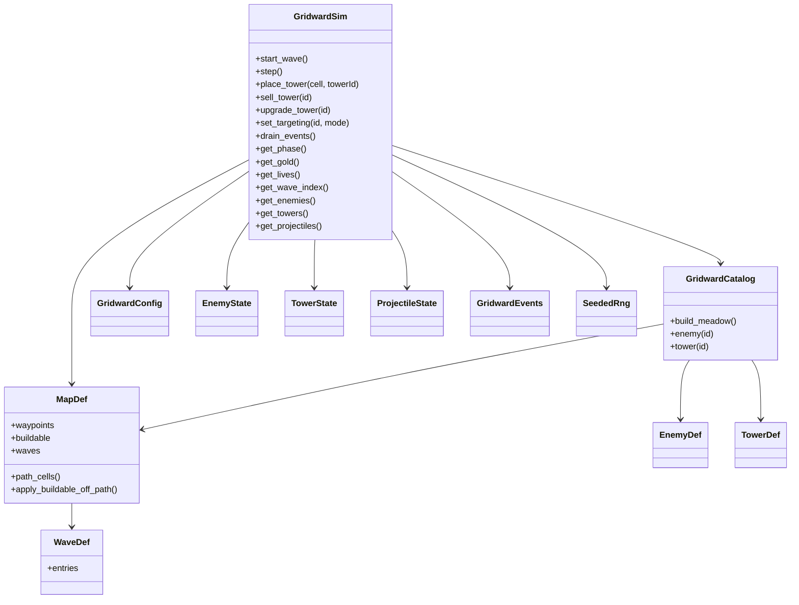
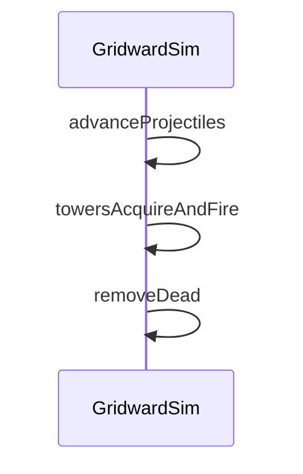

# Gridward sim

Headless content and match loop. `GridwardCatalog` builds defs in code. `GridwardSim` steps the match from those defs. Scripts under `games/gridward/sim/` are `RefCounted` and stay free of `Node`, the scene tree, wall-clock `Time`, unseeded RNG, and `FileAccess`.

Product numbers are copied from [spec.md](../spec.md) §§5–9. Phase transitions are drawn in [flow.md](../explanation/flow.md).

## Ownership



`enemy(id)` and `tower(id)` return a new def on each call. An unknown id returns `null`. `GridwardConfig` is a separate tunable bag (Normal defaults). The catalog does not load files. The sim constructs its own `GridwardConfig` and a `SeededRng` from the constructor seed.

## GridwardSim

```gdscript
enum Phase { BUILD, WAVE, WAVE_CLEAR, VICTORY, DEFEAT }
func _init(map: MapDef, catalog: GridwardCatalog, seed: int) -> void
func get_phase() -> int
func get_gold() -> int
func get_lives() -> int
func get_wave_index() -> int
func start_wave() -> bool
func step() -> void
func drain_events() -> Array
func get_enemies() -> Array
func get_towers() -> Array
func get_projectiles() -> Array
func place_tower(cell: Vector2i, tower_id: StringName) -> int
func sell_tower(tower_entity_id: int) -> bool
func upgrade_tower(tower_entity_id: int) -> bool
func set_targeting(tower_entity_id: int, mode: StringName) -> void
```

| Method | Behavior |
|--------|----------|
| `_init` | Copies `starting_gold` and `starting_lives`. Phase is `BUILD`, or `DEFEAT` when lives start at 0 or below. Owns `SeededRng(seed)` and a default `GridwardConfig`. |
| `get_phase` | `Phase` value as an int. |
| `get_gold` | Current gold. Leaks do not change it. |
| `get_lives` | Lives remaining after leaks. |
| `get_wave_index` | Active wave during `WAVE` and `WAVE_CLEAR`. Next wave during `BUILD` after a clear. `0` before the first wave. Stays on the last index at `VICTORY`. |
| `start_wave` | From `BUILD` only, when lives are above 0 and a wave remains. Enters `WAVE`, schedules that wave, emits `wave_started`. Returns false otherwise. |
| `step` | One `FixedTick.SEC` of the wave, or the exit from `WAVE_CLEAR`. No-op in `BUILD`, `VICTORY`, and `DEFEAT`. |
| `drain_events` | Returns queued event dictionaries and clears the queue. |
| `get_enemies` | Shallow copy of living `EnemyState`s in spawn order. |
| `get_towers` | Shallow copy of placed `TowerState`s in place order. |
| `get_projectiles` | Shallow copy of shells still in flight. |
| `place_tower` | Entity id, or `-1`. See [Placement](#placement). |
| `sell_tower` | Refunds `floor(invested * sell_refund)` and removes the tower. False when the phase is closed or the id is missing. |
| `upgrade_tower` | Pays the next-tier cost, then scales damage and range. False at `max_tier`, when gold is short, or when the phase is closed. |
| `set_targeting` | Sets `first`, `last`, `closest`, `strongest`, or `weakest`. Unknown modes and missing ids do nothing. |

`step` during `WAVE`, in order: spawn entries whose tick is due, move every living enemy, resolve combat while the phase is still `WAVE`, then either enter `WAVE_CLEAR` or advance the wave tick. Enemies move on the tick they spawn. Spawn position in the event is the first waypoint, before that tick's move. A leak that sets `DEFEAT` skips combat on that step.

### Placement

`place_tower` succeeds only in `BUILD` or `WAVE`, on an in-bounds buildable cell, for a catalog id listed in `map.unlocked_towers`, when gold covers the tier-0 cost and the cell is empty. It deducts that cost, stores it as `invested`, and returns a new entity id starting at 0. Ids are not reused after a sell. The tower's world position is the cell index (`Vector2(cell)`), the same space enemies walk. Cooldown starts at 0.

`sell_tower` adds `floor(invested * sell_refund)` gold. `invested` is the build cost plus every upgrade paid. With the Normal refund `0.70`, a tier-0 bolt (50) refunds 35. The cell is free afterward. Shells already in flight keep going.

`upgrade_tower` from tier `t` costs `round(base_cost * upgrade_cost_factor * pow(upgrade_cost_growth, t))`. Godot `roundi` rounds halves away from zero, so bolt `t = 0` costs `round(37.5) = 38` and `t = 1` costs `round(58.125) = 58`. Damage becomes `round(base_damage * pow(tier_damage_scale, tier))` (at least 1). Range becomes `base_range * pow(tier_range_scale, tier)`. Bolt tier 1 is damage 16 and range 2.7. Tier 2 is damage 22 and range 2.916. Tiers stop at `max_tier` (2). Cooldown length does not change.

### Combat



Shells already in flight move first, at `ProjectileState.SPEED` (6) cells per second. A shell homes on its target while that enemy is alive, then splashes at the impact point. A new shell spawns at the tower cell and does not move until the next combat step.

A tower with `cooldown` 0 and a target fires on that step, then waits `cooldown_ticks` combat steps. Bolt (30) fires on a step and again 30 combat steps later. Cooldown counts down only inside WAVE combat. No target leaves `cooldown` at 0.

Acquire keeps enemies inside range (`distance <= range`), alive, and engageable. Air enemies are engageable only when `anti_air` is set and `ground_only` is clear, so bolt ignores flyers and flak can hit them. The default mode is `first`.

| Mode | Winner |
|------|--------|
| `first` | Greatest distance along the waypoint polyline |
| `last` | Least distance along the polyline |
| `closest` | Smallest distance to the tower cell |
| `strongest` | Highest current HP |
| `weakest` | Lowest current HP |

Equal metrics keep the lowest entity id.

`hitscan` (bolt, and frost or flak without their later specials) applies damage on the fire step. `projectile` (mortar) flies, then damages every engageable enemy within `splash_radius` of the impact, including the aim point. Full damage, no falloff. `continuous` (beam) does not fire; ramp is not implemented.

Each hit subtracts the enemy's armor and deals at least `min_damage`. HP does not go below 0. A kill removes the enemy and emits `enemy_killed`. Gold is unchanged on a kill. Entering `WAVE_CLEAR` drops shells still in flight.

### Spawn schedule

For each entry, enemy `i` (0-based) is due at `delay_ticks + i * spacing_ticks`. Entries are walked in order. Equal ticks keep that order. When `spawn_jitter_ticks` is greater than 0, each due tick adds `SeededRng.randi_range(-jitter, jitter)` and clamps at 0. The default is 0, so v1 waves do not draw from the generator.

Unknown `enemy_id` values consume the slot and spawn nothing.

### Path and leaks

`EnemyState.advance(distance, waypoints)` walks the polyline. `distance` is `speed * FixedTick.SEC`. When a segment ends, leftover distance continues onto the next segment in the same call. Reaching the last waypoint leaks: the enemy is removed, lives drop by 1 (not below 0), and an `enemy_leaked` event records the new total.

Lives at 0 set `DEFEAT` during that move. That step does not enter `WAVE_CLEAR` or `VICTORY`. Later `step` calls do not move the survivors.

### Wave clear

`WAVE_CLEAR` begins on the step where every slot has spawned and no enemies remain. The following `step()` goes to `BUILD` and increments `wave_index` when another wave exists, or to `VICTORY` on the last wave.

Spawned HP is `maxi(roundi(base_hp * pow(hp_scale, wave_index) * difficulty_hp), 1)` using the sim's config (Normal: `hp_scale` 1.12, `difficulty_hp` 1).

## EnemyState

| Field | Meaning |
|-------|---------|
| `id` | Spawn order, starting at 0 for the match |
| `enemy_id` | `EnemyDef.id` |
| `hp` | Scaled hit points at spawn |
| `speed` | Cells per second, copied from the def |
| `position` | Cell-space point on the polyline |
| `segment` | Waypoint index that starts the current segment |
| `segment_distance` | Cells already traveled on that segment |

`advance(distance: float, waypoints: PackedVector2Array) -> bool` returns true when the enemy has reached the last waypoint.

## TowerState

One placed tower. `damage` and `range` are the tier-scaled stats. `base_damage`, `base_range`, and `base_cost` stay at the tier-0 def so later tiers do not compound rounding. `invested` is gold spent on the build and upgrades. `cooldown` is ticks until the tower may fire. `targeting` is one of `TowerState.TARGET_FIRST`, `TARGET_LAST`, `TARGET_CLOSEST`, `TARGET_STRONGEST`, `TARGET_WEAKEST`.

`is_targeting_mode(mode) -> bool` accepts only those five modes.

## ProjectileState

One shell. `SPEED` is 6 cells per second. `position` and `destination` are cell-space points. `splash_radius` 0 hits only `target_enemy_id`. Copied `damage`, `anti_air`, and `ground_only` stay with the shell after the tower is sold or upgraded.

## GridwardEvents

`type` is a `StringName`.

| Constant | `type` | Fields |
|----------|--------|--------|
| `WAVE_STARTED` | `wave_started` | `wave_index` |
| `ENEMY_SPAWNED` | `enemy_spawned` | `id`, `enemy_id`, `position` |
| `ENEMY_LEAKED` | `enemy_leaked` | `id`, `enemy_id`, `lives` |
| `WAVE_CLEARED` | `wave_cleared` | `wave_index` |
| `VICTORY` | `victory` | |
| `DEFEAT` | `defeat` | |
| `TOWER_PLACED` | `tower_placed` | `id`, `tower_id`, `cell`, `gold` |
| `TOWER_SOLD` | `tower_sold` | `id`, `refund`, `gold` |
| `TOWER_UPGRADED` | `tower_upgraded` | `id`, `tier`, `cost`, `gold` |
| `TOWER_FIRED` | `tower_fired` | `id`, `tower_id`, `target_id`, `kind` |
| `PROJECTILE_SPAWNED` | `projectile_spawned` | `id`, `tower_entity_id`, `position`, `target_id` |
| `PROJECTILE_IMPACT` | `projectile_impact` | `id`, `position`, `splash_radius` |
| `ENEMY_HIT` | `enemy_hit` | `id`, `damage`, `hp`, `tower_entity_id` |
| `ENEMY_KILLED` | `enemy_killed` | `id`, `enemy_id` |

Static helpers with those names build the dictionaries. `position` on a spawn is the first waypoint before movement. `lives` on a leak is the total after that leak. On tower events, `id` is the tower entity id and `gold` is the total after the change. On `tower_fired`, `id` is the tower and `target_id` is the enemy. On projectile events, `id` is the shell. On `enemy_hit` and `enemy_killed`, `id` is the enemy. `hp` is the value after the hit. A kill does not add bounty.

## GridwardConfig

| Field | Normal default | Role |
|-------|----------------|------|
| `hp_scale` | 1.12 | `hp * pow(hp_scale, wave_index)` |
| `sell_refund` | 0.70 | fraction of invested cost |
| `wave_clear_bonus_base` | 25 | clear gold base |
| `wave_clear_bonus_per_index` | 5 | added once per wave index |
| `early_call_ticks_per_gold` | 30 | `floor(remaining_ticks / this)` |
| `early_call_gold_cap` | 40 | early-call gold cap |
| `upgrade_cost_factor` | 0.75 | `round(base_cost * factor * pow(growth, t))` |
| `upgrade_cost_growth` | 1.55 | upgrade curve base |
| `tier_damage_scale` | 1.35 | damage growth per tier above 0 |
| `tier_range_scale` | 1.08 | range growth per tier above 0 |
| `max_tier` | 2 | tiers 0–2 |
| `min_damage` | 1 | damage left after armor |
| `slow_cap` | 0.60 | max slow fraction |
| `burn_max_stacks` | 5 | burn stack cap |
| `burn_damage_per_stack` | 1 | burn damage per tick per stack |
| `spawn_jitter_ticks` | 0 | spawn timing jitter |
| `difficulty_hp` | 1.0 | caller-applied HP multiplier |
| `difficulty_gold` | 1.0 | caller-applied gold multiplier |

Difficulty presets on the type: Easy `EASY_HP` 0.85 / `EASY_GOLD` 1.15, Normal `NORMAL_HP` 1 / `NORMAL_GOLD` 1, Hard `HARD_HP` 1.25 / `HARD_GOLD` 0.9. Assign them onto `difficulty_hp` and `difficulty_gold`.

## MapDef

| Field | Meaning |
|-------|---------|
| `id` | `StringName` |
| `width`, `height` | cell counts |
| `waypoints` | `PackedVector2Array` of cell indices |
| `buildable` | `PackedByteArray`, row-major `y * width + x`, `1` buildable, `0` path |
| `starting_gold`, `starting_lives` | match start |
| `waves` | `Array[WaveDef]` |
| `unlocked_towers` | tower ids the player may place |

`path_cells()` walks the polyline one cell at a time. Orthogonal segments include every cell on the segment. `apply_buildable_off_path()` sets the mask from that walk: path cells are `0`, every other in-bounds cell is `1`. `cell_index(cell)` is `y * width + x`. `is_buildable(cell)` is false outside the map.

### WaveDef entries

Each entry is a `Dictionary`:

| Key | Type |
|-----|------|
| `enemy_id` | `StringName` |
| `count` | `int` |
| `spacing_ticks` | `int` |
| `delay_ticks` | `int` |

Ticks are `FixedTick` steps (1/60 s). Cooldowns and spawn spacing are already in ticks.

## EnemyDef

`speed` is cells per second. Stats are wave-1 Normal, before `hp_scale`.

| Id | HP | Speed | Bounty | Armor | Air | Group | Boss |
|----|----|-------|--------|-------|-----|-------|------|
| grunt | 40 | 1.2 | 8 | 0 | | | |
| runner | 24 | 2.4 | 10 | 0 | | | |
| tank | 120 | 0.7 | 18 | 4 | | | |
| swarm | 12 | 1.8 | 3 | 0 | | yes | |
| flyer | 36 | 1.6 | 14 | 0 | yes | | |
| boss | 800 | 0.55 | 100 | 6 | | | yes |

Published order: `GridwardCatalog.ENEMY_IDS`.

## TowerDef

`range` is cells. `kind` is `hitscan`, `projectile`, or `continuous` (`TowerDef.KIND_*`). `splash_radius` 0 is single-target. `slow_factor` 0 means no slow. `ramp_damage` 0 means damage does not ramp; a beam starts at `damage` and ramps to `ramp_damage`.

| Id | Cost | Range | Cooldown | Damage | Kind | Extra |
|----|------|-------|----------|--------|------|-------|
| bolt | 50 | 2.5 | 30 | 12 | hitscan | ground only, starter |
| mortar | 80 | 3.5 | 75 | 28 | projectile | splash 1.2, ground only |
| frost | 70 | 2.2 | 45 | 4 | hitscan | slow 0.35 for 90 ticks, ground only |
| flak | 90 | 3.0 | 24 | 10 | hitscan | anti-air and ground |
| beam | 110 | 2.8 | 6 | 3 → 12 | continuous | ramp, ground only |

Published order: `GridwardCatalog.TOWER_IDS`.

## Meadow

`GridwardCatalog.build_meadow()` returns map id `meadow`.

| Field | Value |
|-------|-------|
| Size | 16×10 |
| Starting gold | 120 |
| Starting lives | 20 |
| Unlocked towers | bolt |
| Waves | 10, grunt and runner only |

Waypoints (cell indices), an orthogonal S from the west edge to the east edge:

`(0, 1) → (12, 1) → (12, 4) → (3, 4) → (3, 7) → (15, 7)`

| Wave | Entries (`enemy_id`, count, spacing_ticks, delay_ticks) |
|------|----------------------------------------------------------|
| 0 | grunt 4 / 70 / 0 |
| 1 | grunt 6 / 60 / 0 |
| 2 | runner 4 / 50 / 0 |
| 3 | grunt 5 / 60 / 0, then runner 3 / 45 / 360 |
| 4 | grunt 5 / 80 / 0 |
| 5 | runner 6 / 40 / 0 |
| 6 | grunt 6 / 50 / 0, then runner 5 / 36 / 320 |
| 7 | grunt 10 / 45 / 0 |
| 8 | runner 8 / 35 / 0 |
| 9 | grunt 8 / 40 / 0, then runner 8 / 30 / 360 |

Waves 0–1 teach the grunt. Wave 2 introduces the runner. Wave 4 is a wider-spaced rest. Wave 9 is the mixed climax. The full enemy and tower tables above still exist on the catalog for later maps.
