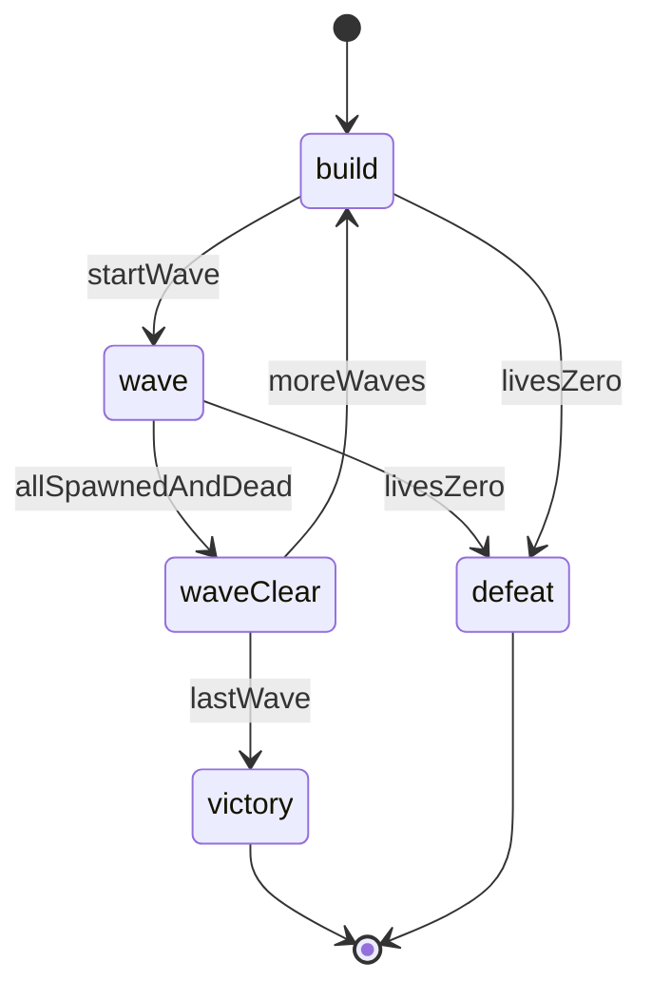
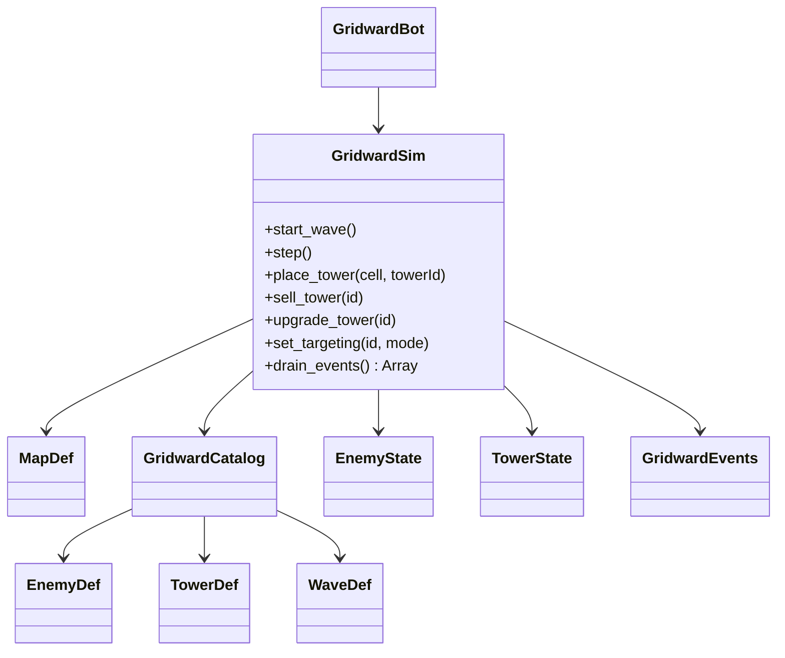
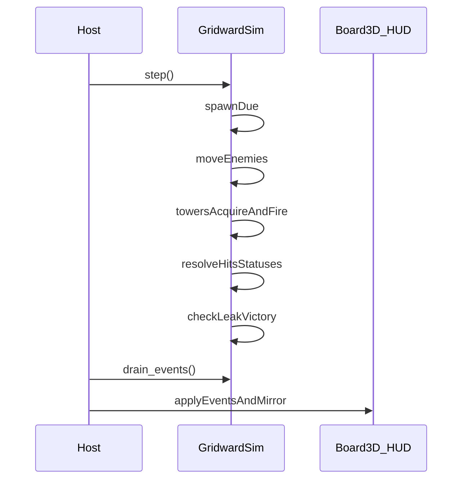

# Gridward — product and systems specification

Solo **fixed-path** tower defense with a short campaign. Rules are headless
(`RefCounted`, `SeededRng`, `FixedTick.SEC`); the 3D board and HUD only present
sim state. Implementation order: [plans/00-roadmap.md](plans/00-roadmap.md).

## 1. Pitch and pillars

**Pitch.** You place towers on a grid beside a fixed lane. Waves of enemies walk
the path. Kill for gold, leak lives. Clear the campaign maps.

**Pillars**

1. Planning is readable at a glance (clear path, clear ranges).
2. Waves are deterministic and seed-driven — fair to retry.
3. Short campaign (5 maps) that teaches one idea per map.

## 2. Core loop

Build → start wave → enemies path while towers auto-fire → gold from kills /
lives from leaks → wave clear → repeat. Last wave cleared → victory. Lives ≤ 0
→ defeat.

## 3. Sim rules (headless)

| Rule | Value |
|------|-------|
| Grid | Default **16×10** cells; 1 world unit per cell |
| Time | `FixedTick.SEC` (1/60 s); all cooldowns/spawns in **ticks** |
| Paths | Polylines of waypoints in cell space; leftover distance carries at corners |
| RNG | `SeededRng` only (spawn jitter, optional crits); never global `rand*` |
| Buildable | Boolean mask; never on path cells |
| Authority | Sim owns gold, lives, HP, projectiles; app mirrors |

No `Node`, `Engine`, wall-clock `Time`, or `FileAccess` in sim.

## 4. Phase state machine



`paused` is **app-only** (host stops calling `step()`). Sim does not model pause.

## 5. Entities

### 5.1 Enemies (base stats at wave 1, difficulty Normal)

| Id | HP | Speed (cells/s) | Bounty | Armor | Flags |
|----|-----|-----------------|--------|-------|-------|
| grunt | 40 | 1.2 | 8 | 0 | ground |
| runner | 24 | 2.4 | 10 | 0 | ground |
| tank | 120 | 0.7 | 18 | 4 | ground |
| swarm | 12 | 1.8 | 3 | 0 | ground, group |
| flyer | 36 | 1.6 | 14 | 0 | **air** |
| boss | 800 | 0.55 | 100 | 6 | ground, boss |

- **Armor** subtracts from each hit (min 1 damage remaining).
- **Air** can only be targeted by towers with `anti_air`.
- Wave HP scale: `hp * pow(1.12, wave_index)` (0-based wave index).

### 5.2 Towers (tier 0; 3 tiers 0–2)

| Id | Cost | Range | Cooldown ticks | Damage | Kind | Notes |
|----|------|-------|----------------|--------|------|-------|
| bolt | 50 | 2.5 | 30 | 12 | hitscan | default starter |
| mortar | 80 | 3.5 | 75 | 28 | projectile splash r=1.2 | ground only |
| frost | 70 | 2.2 | 45 | 4 | hitscan + slow | slow 35%, 90 ticks |
| flak | 90 | 3.0 | 24 | 10 | hitscan | **anti_air** (+ground) |
| beam | 110 | 2.8 | 6 | 3→12 ramp | continuous | ramp resets on retarget |

Upgrade cost tier *t→t+1*: `round(base_cost * 0.75 * pow(1.55, t))`.  
Stats per tier: damage ×1.35, range ×1.08 (cap documented in balance plan).

### 5.3 Status effects

| Effect | Stacks | Cap | Duration | Notes |
|--------|--------|-----|----------|-------|
| slow | refresh | 60% slow | ticks | frosts refresh; strongest wins |
| burn | stack intensity | 5 stacks | ticks | DoT per tick = stack×1 |

## 6. Targeting

Modes: `first` (default), `last`, `closest`, `strongest`, `weakest`.

- Filter: in range, alive, tower may engage (air/ground).
- Tie-break: lowest entity `id` (spawn order). Deterministic.

## 7. Economy

| Event | Formula |
|-------|---------|
| Kill bounty | enemy.bounty (unscaled) |
| Wave clear bonus | `25 + 5 * wave_index` |
| Early call | If player starts next wave while idle in build with timer remaining: `floor(remaining_ticks / 30)` gold (cap 40) |
| Sell refund | `floor(invested_cost * 0.70)` |
| Starting gold | map-defined (Meadow: 120) |
| Starting lives | map-defined (Meadow: 20) |

**Lane holds (sanity).** For each wave, sum over covering towers:

`damage_dealt ≈ tower_dps * (range_coverage_length / enemy_speed)`

Require `sum_damage >= enemy_hp * safety` with `safety ≈ 1.15` on Normal for map 1
mid waves (encoded as GUT in plan 05).

## 8. Waves

`WaveDef` = ordered list of entries:

```text
{ enemy_id, count, spacing_ticks, delay_ticks }
```

- 10–15 waves per map.
- Next-wave preview exposes enemy ids and counts (no fog of war).
- Spawn uses `SeededRng` for optional ±jitter ticks (config; default 0 for v1 determinism tests).

## 9. Campaign

| Map | Teach | Waves | Unlock |
|-----|-------|-------|--------|
| 1 Meadow | bolt + build | 10 | start |
| 2 Bend | mortar splash | 12 | 1★ on Meadow |
| 3 Skyreach | flyer + flak | 12 | Bend |
| 4 Bastion | tank armor + frost | 14 | Skyreach |
| 5 Citadel | boss + beam | 15 | Bastion |

Difficulties: Easy (HP ×0.85, gold ×1.15), Normal (1.0), Hard (HP ×1.25, gold ×0.9).

Stars from lives remaining at victory: ≥15 → 3★, ≥8 → 2★, else 1★ (tunable per map).

## 10. Architecture



**Boundary.** App calls public sim API and reads state/events. No rules in Nodes.



## 11. App presentation

- `SubViewport` + procedural meshes (Districts / Fairway pattern). Skip meshes when
  `DisplayServer.get_name() == "headless"`.
- Camera: orbit / pan / dolly / fit (`camera-systems`).
- Pick: ray → Y=0 plane → cell; placement ghost green/red.
- Sim speed: 1× or 2× (host calls `step()` once or twice per frame).
- HUD: lives, gold, wave index, build bar (1–5), selected tower panel
  (upgrade / sell / targeting), next-wave preview, Start Wave / Early Call.
- Scenes: `menu`, `map_select`, `play`, `pause_menu`, `results` under
  `games/gridward/app/`; host extends `LayeredHost`.

## 12. Art and audio

- Board: low-poly boxes / cylinders; locked lab palette.
- UI icons: `pixel-art-pxl` under `art/gridward/` → `games/gridward/assets/pxl/`.
- Audio: event → `NullAudio` in tests / `GodotAudio` in play (`game-audio`).

## 13. Controls

| Input | Action |
|-------|--------|
| LMB empty buildable | Place selected tower |
| LMB tower | Select |
| RMB / Sell | Sell selected |
| 1–5 | Select tower type |
| Space | Start / early-call wave |
| F | Fit camera |
| Tab | Toggle 1× / 2× |
| Esc | Pause |

## 14. Test matrix

| Suite | Asserts |
|-------|---------|
| data | path on-grid; buildable off path; waves ref known ids |
| core | spawn order; leftover pathing; leak −life; wave clear; victory/defeat |
| determinism | same seed → identical event log / gold / lives |
| towers | place cost; targeting modes; splash radius; anti-air filter |
| economy | bounty; bonus; sell 70%; upgrade cost |
| status | slow cap; burn tick damage |
| bot | clears Meadow Normal |
| host_flow | menu → map → play → pause → results |
| save | progress round-trip + version migration |

## 15. Non-goals and risks

**Non-goals (v1):** maze path rebuild, multiplayer, skeletal meshes, infinite
endless mode, hero units.

**Risks**

| Risk | Mitigation |
|------|------------|
| Balance swings | Bot harness + lane-holds GUT (plans 05, 07) |
| 3D draw cost | MultiMesh / pooling (plan 12) |
| Scope creep | Fixed path only; 5 maps; follow plans 01–12 |

## 16. Definition of shipped

- All plans 01–12 complete with green GUT for `tests/games/gridward/`.
- Campaign playable Meadow → Citadel on Normal.
- Diátaxis `reference/sim.md`, `reference/app.md`, `explanation/flow.md` present.
- Registered in lab launcher as **Gridward**.
