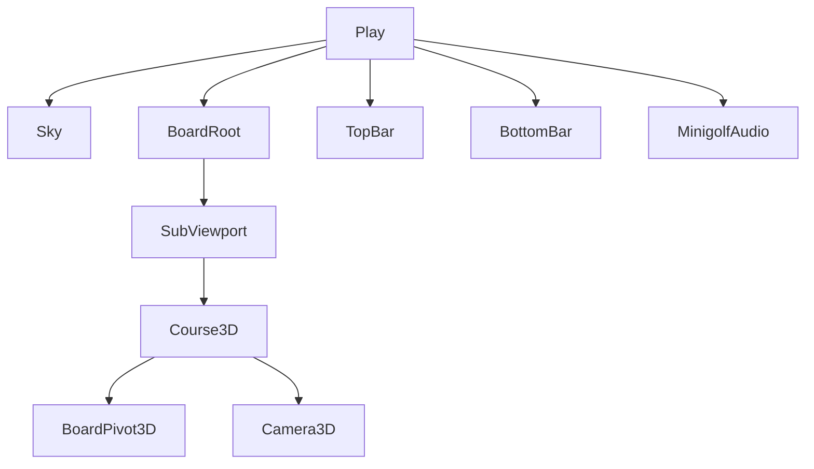

# Fairway Circuit app

| Scene | Role |
|-------|------|
| `menu` | Play / Quit |
| `setup` | 1–4 seats, bot toggles (P1 human) |
| `play` | SubViewport `Course3D` + HUD |
| `pause_menu` | Resume / Quit to menu |
| `results` | Rankings from host meta |

## Course3D

Proxy-faithful meshes: fairway box, wall boxes (BoxMesh along +X, yaw `atan2(-dz, dx)` so segments match sim), bunker cylinders, cup+flag, muted tee disc. Hole 6 shows a tilted pad mesh over the damp region. Trees sit outside bounds. Camera pitch ~40°, LMB-drag orbit, click (no drag) aims via camera→Y=0 ray, MMB/RMB pan, wheel dolly, Fit biases focus toward the tee. During `moving`, focus leans toward the ball (`FOLLOW_LEAN`). Sun casts shadows.

Headless skips mesh creation (`DisplayServer` name `headless`).

## HUD / input

- Top: hole / par / stroke / player; Fit
- Aim: click fairway → ray to green; yellow shaft arrow from ball
- Power: hold Space, release → `stroke()`
- Tab scorecard; Esc pause; short feed tip
- Bots: `bot_act` on cooldown; ball ticks while `moving`
