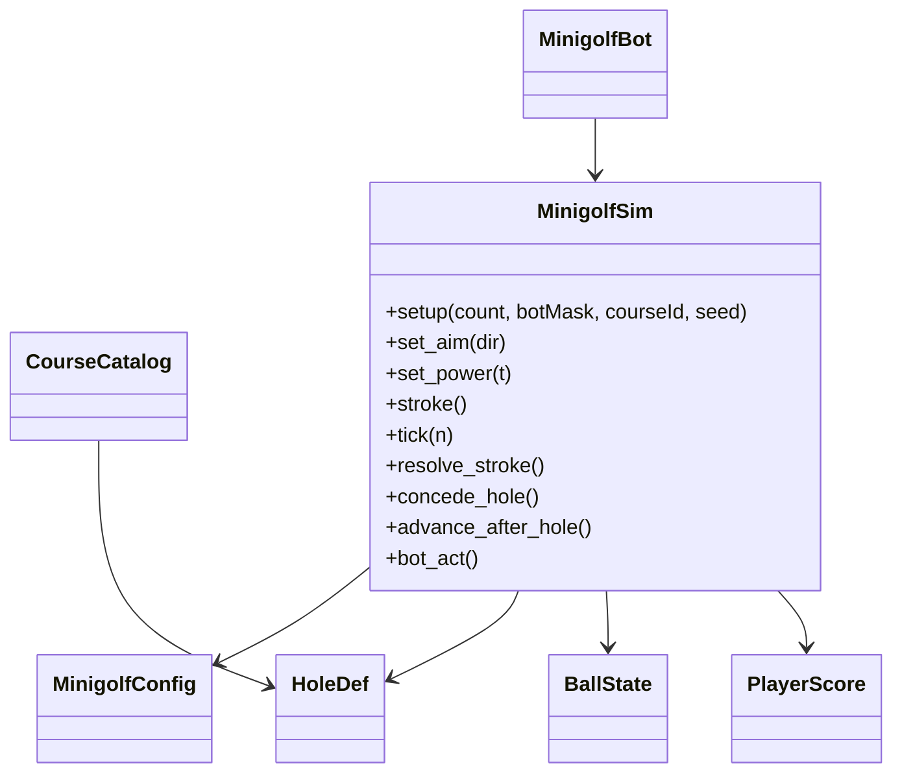

# Fairway Circuit sim

Flat XZ proxy physics: semi-implicit Euler, kinetic friction, wall/blocker mirror bounce (`restitution` 0.55), cup sink when near and slow, OOB resets to last fairway. Course `fairway_park` has 9 holes from `CourseCatalog.build_fairway_park()`.

Phases: `aim` | `power` | `moving` | `hole_result` | `course_over`.

Hotseat is **per-hole**: every seat finishes the current hole before `advance_after_hole`.

## Events

| type | payload |
|------|---------|
| `aim_changed` | player, dir |
| `power_changed` | player, power |
| `stroke_started` | player, dir, power, impulse |
| `ball_moved` | pos, vel (throttled) |
| `bounced` | normal, speed |
| `stopped` | pos |
| `sunk` | player, strokes, par |
| `oob_reset` | pos |
| `hole_complete` | hole_index, scores_slice |
| `turn_changed` | player, hole |
| `course_complete` | winner, rankings |
