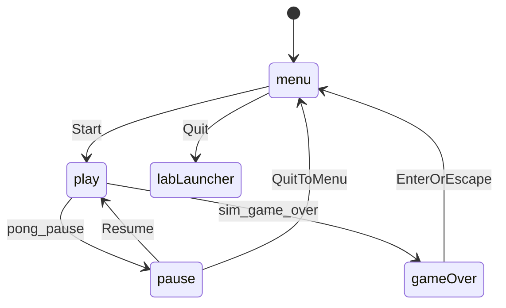

# Pong scene flow

The host is the only node that changes scenes. Menu, play, and pause enqueue a `SceneRequest` and return. The host applies the queue in `_process` (and once in `_ready` for the first menu).

`SceneStack` keeps path strings. The host calls `paths()` and syncs `Content` as **layers**: `PUSH` adds a child without freeing lower scenes; `POP` frees only the top child; `REPLACE` rebuilds from the mismatch point. Lower layers use `PROCESS_MODE_DISABLED` while an overlay is on top, so play stops stepping the sim during pause.

`QUIT` stays in the `apply` result and does not pop the stack. The pong host treats Quit as return-to-lab when nested under the lab shell; standalone it quits the tree.

Leaving pause for the main menu is a **batch**: `POP` then `REPLACE` menu (pause alone must not `REPLACE`, or play would remain under the menu).

Rally status stays inside `PongSim`. The play scene reads `get_status()`. When the sim reports `game_over`, Enter or Escape replaces play with the menu. During `playing` / `scored`, `pong_pause` pushes the pause overlay.

