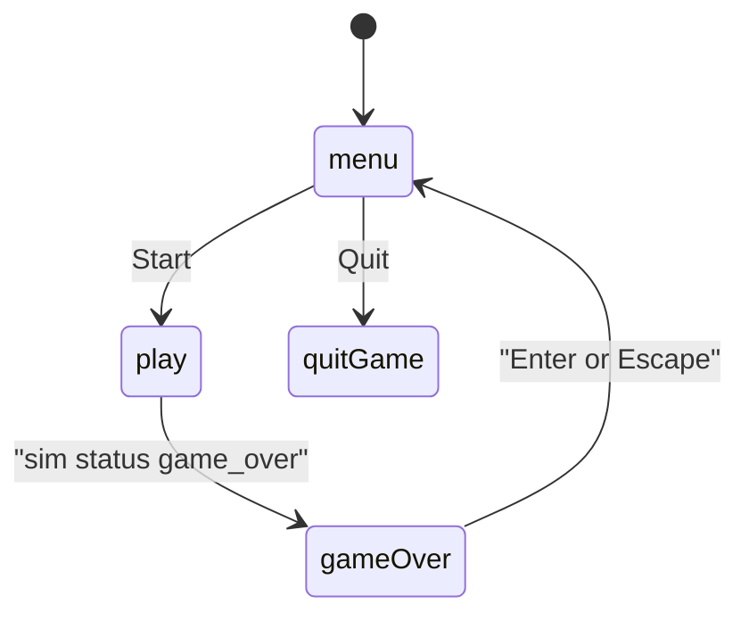
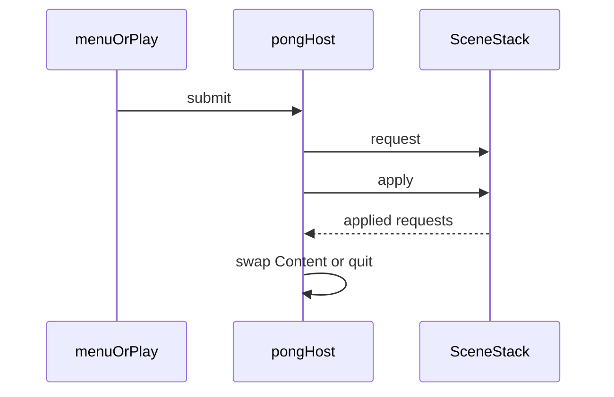

# Pong scene flow

The host is the only node that changes scenes. Menu and play enqueue a `SceneRequest` and return. The host applies the queue in `_process` (and once in `_ready` for the first menu) so a button press is not freed mid-signal.

`SceneStack` keeps path strings. `QUIT` stays in the `apply` result and does not pop the stack. The host sees that kind and quits the tree.

Rally status stays inside `PongSim`. The play scene reads `get_status()`. It does not decide points or the winner. When the sim reports `game_over`, the scene shows the winner from the sim event and waits for Enter or Escape before replacing itself with the menu.

Start replaces the menu with play. Quit asks the process to exit. After a winning point, play stays on screen until Enter or Escape replaces it with the menu. A new play scene builds a new `PongSim`.
