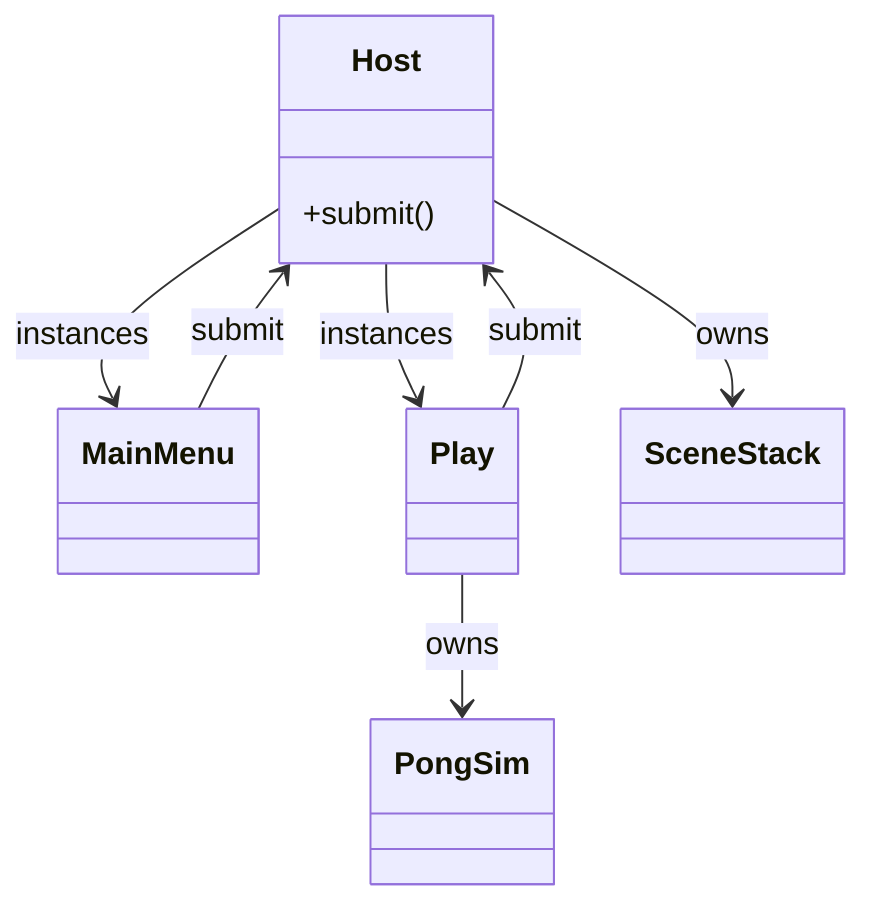

# Pong app

Presentation for Pong lives in `games/pong/app/`. `project.godot` sets `run/main_scene` to `res://games/pong/app/host.tscn`. Scenes draw with `ColorRect` and `Label` nodes. They do not embed rally rules.



## Host

`host.tscn` is a `Control` named `Host` with script `host.gd`. Its child `Content` is a full-rect `Control`.

| Piece | Behavior |
|-------|----------|
| `SceneStack` | Created with the host. Stores the path stack and the pending `SceneRequest` queue. |
| `_ready` | Sizes the window to `PongConfig` court width and height, `submit`s `SceneRequest.replace` of `res://games/pong/app/main_menu.tscn`, then applies and instances that scene under `Content`. |
| `submit(req)` | Appends `req` to the host queue. Menu and play call this. They walk parents for the first node with `submit`. |
| `_process` | Flushes the queue: `SceneStack.request` for each item, then `apply`. |
| `QUIT` | If any applied request has `SceneRequest.Kind.QUIT`, the host calls `get_tree().quit()` and does not swap. |
| Path change | When `peek()` differs from the scene under `Content`, the host frees that child and `load`s the new `PackedScene`. |

An empty stack `peek()` is `""`. The host then leaves `Content` empty.

## Main menu

`main_menu.tscn` is a full-rect `Control`. It shows a title, a control hint, and two buttons.

| Button | Request |
|--------|---------|
| Start | `SceneRequest.replace("res://games/pong/app/play.tscn")` |
| Quit | `SceneRequest.quit()` |

Start takes keyboard focus when the menu is ready.

## Play

`play.tscn` is a `Node2D`. `_ready` builds `PongConfig.new()`, `SeededRng.new(1)`, and `PongSim.new(config, rng)`. Serve direction repeats for that seed.

`_physics_process` reads the left paddle and steps the sim until status is `game_over`:

- Up is `ui_up` or `KEY_W`. Down is `ui_down` or `KEY_S`. Both or neither latches `0`. The value passed to `set_input` is `-1`, `0`, or `1`. The right-paddle argument is `0` because the sim ignores it.
- Time accumulates in `_physics_process` and each slice calls `step(FixedTick.SEC)`.
- `game_over` events store the `winner` string for the banner. Scores and body positions come from the sim getters.

View mapping: sim coordinates are body centers with the origin at the top-left. Each `ColorRect` position is that center minus half the paddle size, or minus `ball_radius` for the ball. A dim vertical rect marks the midline. It is not a collider.

| Node | Shows |
|------|--------|
| `LeftPaddle`, `RightPaddle`, `Ball` | Sim centers |
| `Score` | `get_left_score()` and `get_right_score()` |
| `Banner` | Visible only when `get_status()` is `game_over` |

On `game_over`, `ui_accept` (Enter) or `ui_cancel` (Escape) submits `SceneRequest.replace` of the main menu. Further play input does not move paddles or step the sim.

## Run

```sh
godot --path .
```
