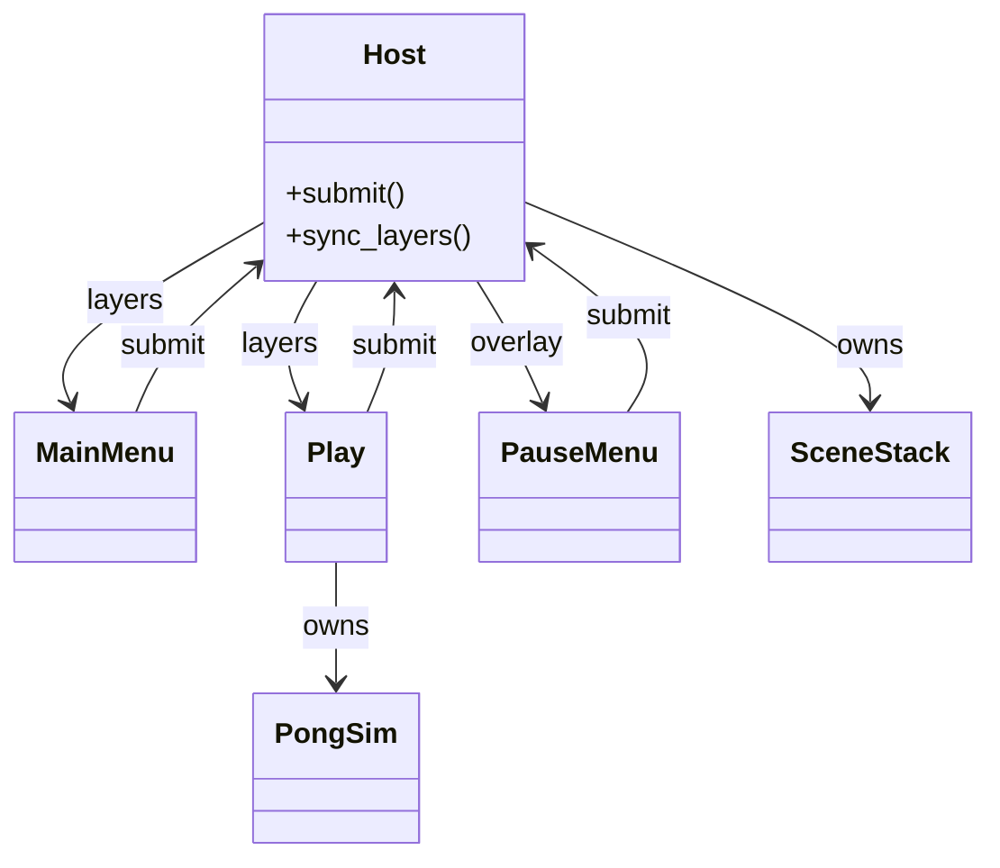

# Pong app

Presentation for Pong lives in `games/pong/app/`. The game entry is `host.tscn` (extends `lab/layered_host.gd`), launched from the lab shell. Scenes draw with `ColorRect` and `Label` nodes. They do not embed rally rules.



## Host

`host.tscn` extends `LayeredHost`. `_boot` sizes the window to `PongConfig` and `REPLACE`s the main menu. `_on_quit_requested` calls lab `return_to_launcher` (deferred) when nested; otherwise `get_tree().quit()` for standalone/tests.

## Main menu

| Button | Request |
|--------|---------|
| Start | `REPLACE` play |
| Quit | `QUIT` → returns to lab launcher when nested |

## Play

Builds `PongConfig`, `SeededRng(1)`, and `PongSim`. Steps on `FixedTick.SEC`.

| Action | Binding |
|--------|---------|
| `pong_move_up` | W, Up |
| `pong_move_down` | S, Down |
| `pong_pause` | Escape, P — `PUSH` pause (not in `game_over`) |
| `ui_accept` / `ui_cancel` | After `game_over` — `REPLACE` menu |

## Pause

Semi-transparent overlay over live play.

| Control | Request |
|---------|---------|
| Resume / `pong_pause` / `ui_cancel` | `POP` |
| Quit to menu | `POP` then `REPLACE` menu (one flush batch) |

## Run

```sh
godot --path .
```
