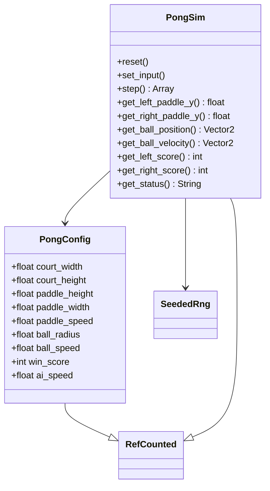
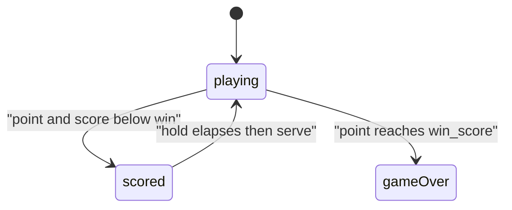
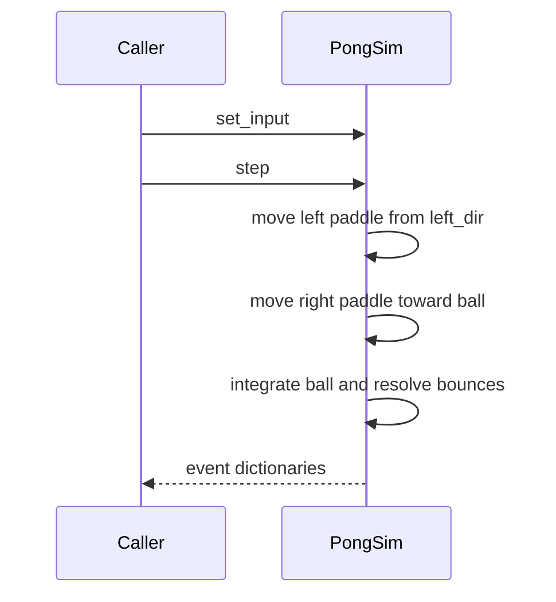

# Pong sim

`PongConfig` and `PongSim` are `RefCounted` types under `games/pong/sim/`. They do not use `Node`, the scene tree, wall-clock time, `FileAccess`, or global `rand*`. Rally time advances only when the caller calls `step`. Serve direction and angle come from the injected `SeededRng`.

## Coordinates

The court origin is the top-left. `+x` points right and `+y` points down. Paddle `y` values and the ball position are centers.

| Body | Center x |
|------|----------|
| Left paddle | `paddle_width / 2` |
| Right paddle | `court_width - paddle_width / 2` |
| Ball on serve | `(court_width / 2, court_height / 2)` |

Paddle centers stay inside `[paddle_height / 2, court_height - paddle_height / 2]`.

## PongConfig

`PongConfig.new()` fills these defaults. The sim keeps the same instance, so later field writes apply on the next `step` or `reset`.

| Field | Default | Role |
|-------|---------|------|
| `court_width` | `800` | Court width in pixels |
| `court_height` | `450` | Court height in pixels |
| `paddle_height` | `80` | Both paddles |
| `paddle_width` | `12` | Both paddles |
| `paddle_speed` | `420` | Left paddle, pixels per second |
| `ball_radius` | `8` | Ball circle radius |
| `ball_speed` | `360` | Ball speed, pixels per second |
| `win_score` | `5` | First side to reach this wins |
| `ai_speed` | `320` | Right paddle tracking speed, pixels per second |

## PongSim

`_init(config, rng)` stores both objects and calls `reset`. `reset` zeroes scores and the latched left direction, centers both paddles, sets status to `playing`, and serves.

### Input

`set_input(left_dir, right_dir)` latches `left_dir` after clamping it to `-1`, `0`, or `1`.

- `-1` moves the left paddle toward smaller `y` (up).
- `1` moves it toward larger `y` (down).
- `0` leaves it in place.

The value stays latched until the next `set_input` or `reset`. It is applied only on `playing` steps, at `paddle_speed` pixels per second.

`right_dir` is accepted and ignored. Each `playing` step moves the right paddle toward the ball's current `y` at `ai_speed`, then clamps it to the court. A `right_dir` of `-1` or `1` does not change that chase.

### step

`step(dt = FixedTick.SEC)` advances one slice of rally time and returns an `Array` of event dictionaries. Pass `FixedTick.SEC` from the presentation shell so sim time stays on the lab tick.

| Status before the call | What `step` does |
|------------------------|------------------|
| `game_over` | Returns an empty array. Scores, paddles, and the ball stay as they are. |
| `scored` | Counts down a 0.5 second hold. While the hold remains, the ball stays put and no events are emitted. When the hold elapses, the sim serves and sets status to `playing`. |
| `playing` | Moves the left paddle, tracks with the right paddle, integrates the ball, then resolves walls, paddles, and goals. |

Walls: if the ball center crosses the top or bottom by `ball_radius`, `y` is clamped back inside and `velocity.y` is reflected.

Paddles: a ball moving left can bounce off the left paddle, and a ball moving right can bounce off the right paddle, when the ball center lies within the paddle rectangle expanded by `ball_radius`. The bounce keeps speed `ball_speed`, aims back into the court, and adds an angle from where the ball met the paddle (at most about 0.85 radians off horizontal). The ball is placed just outside the paddle face so the next tick does not hit the same paddle again.

Goals: the whole ball past the left edge (`position.x + radius < 0`) scores for the right. The whole ball past the right edge scores for the left.

### Events

| Dictionary | When |
|------------|------|
| `{"type": "scored", "side": "left"}` or `"right"` | That side's score increases by one. `side` is who scored. |
| `{"type": "game_over", "winner": "left"}` or `"right"` | That side's score reached `win_score`. Emitted on the same `step` as the winning `scored` event. |

After a non-winning point, status is `scored` and the ball velocity is zero until the hold ends. After a winning point, status is `game_over`.

### Getters

| Method | Returns |
|--------|---------|
| `get_left_paddle_y()` | Left paddle center `y` |
| `get_right_paddle_y()` | Right paddle center `y` |
| `get_ball_position()` | Ball center |
| `get_ball_velocity()` | Ball velocity in pixels per second |
| `get_left_score()` | Left score |
| `get_right_score()` | Right score |
| `get_status()` | `"playing"`, `"scored"`, or `"game_over"` |

## Determinism

`SeededRng` is used only in `_serve` (one `randi_range` for horizontal direction, one `randf_range` for the angle). The same seed, the same config, and the same `left_dir` on each `step` produce the same scores, status, paddle positions, and ball state. `right_dir` is not part of that state.
